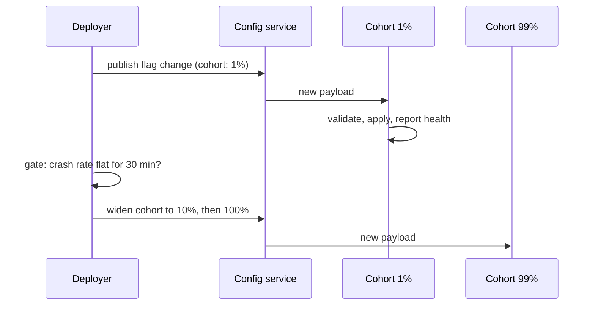

On 2026-09-28 at 17:38 PDT, someone at Google merged a two-line configuration cleanup. By 17:41, iOS apps running Google Analytics for Firebase were crashing on launch. The cleanup removed a stale, legacy flag from the server; a pointer to that flag was left behind in the SDK. When the SDK fetched the missing flag, it hit a fatal error: the flag's name was nil, and nobody had validated that it wasn't.

The server kept serving the malformed payload for 2 hours and 11 minutes. Rollback completed at 19:52. For the entire window, the Firebase and Google Ads status dashboards stayed green, because they measure server-side health and this was a client-side crash. The team found out through crash alerts and GitHub issues, and posted updates in a GitHub thread while the dashboards said nothing was wrong.

This is a case study of that outage, from Google's public postmortem of 2026-10-02. The idea that matters for anyone who ships an SDK or consumes remote config is the one Google committed to in writing: backend data anomalies must not cause app-side crashes. The server is an untrusted input. This article shows the fail-safe fetch contract that follows from that sentence, and ships a tested Python client that implements it: validate every flag, ignore the corrupt ones individually, and fall back to cached defaults.

This article targets **Python 3.12 (stdlib only)** for the reference client, the incident timeline as published in Google's postmortem (2026-10-02), and the Analytics hardening that shipped in Firebase Apple SDK 13.0.0 (2026-10-07).

> [!NOTE]
> **In short**
> - Validate every server payload strictly, per flag. A corrupt or missing flag is ignored individually and counted; it is never fatal.
> - Fall back to cached defaults per flag. The last-known-good config is the source of truth while the server is misbehaving.
> - Roll config out in phases like a binary. A globally-released config system turned a 2-line change into a worldwide crash in 3 minutes.
> - Watch the client, not just the server. Client-side crash and fetch-rejection signals belong on the status page.

## What actually happened

The postmortem is unusually specific, which is what makes it a good case study. The timeline, all times PDT on 2026-09-28:

{: .figure}

Three details are worth sitting with. First, the blast radius came from the config system's own design: these flags double as kill switches for bad SDK releases, so the kill-switch channel is released globally by construction. A cleanup in that channel is a global deploy with no canary. Second, the existing tests passed on the change that caused the outage; the pipeline had no check that a removed flag was still referenced by a shipped client. Third, the crash was one-time per device: after crashing, the SDK fell back to its previous config, so there was no permanent crash loop, but the crash reports queued locally and uploaded on the next successful launch, creating a long tail of alarming telemetry after the fix.

Google's postmortem names four commitments: harden SDK validation (strict per-payload validation; corrupt or missing flags ignored with fallback to cached defaults; a patch within a week; an audit across all other Firebase iOS and Android SDKs), fix the status dashboards (client-side outage coverage, faster manual updates, a real GA4F entry), validate the config pipeline (block releases that orphan identifiers), and phase config rollouts. The receipts exist: Firebase Apple SDK 13.0.0 shipped on 2026-10-07 with documented Analytics hardening changes, followed the same day by 13.0.1, a Zip and Carthage only release carrying the same hardening. What Google did not publish is a count of affected apps; this article does not repeat anyone's estimate.

## The contract: validate every flag, trust none of the payload

The mental model has three rules, and they are the whole article:

1. **The wire is untrusted.** Every key is checked (non-empty string) before use, every value is type-checked against the schema. Unknown keys are ignored for forward compatibility, not fatal. This is the same principle as [validating an OAuth issuer on every discovery path](/posts/oauth-discovery-issuer-validation/): the check has to run on every path, including the one the attacker (or your own cleanup script) controls.
2. **Flags are independent.** A corrupt flag is skipped and counted; it never poisons the valid flags around it. The naive version fails the whole fetch, or worse, the whole process.
3. **The cache is the fallback.** The last-known-good config is persisted atomically and becomes the source of truth while the server misbehaves. A flag the server removed keeps its cached value; the client carries on.

{: .figure}

## Implementation

The complete client is [config_client.py](config_client.py); the proofs are [test_config_client.py](test_config_client.py), nineteen tests, all passing. It is built in five steps, each stating its guarantee.

**Step 1: the schema pins what the client will accept.** A flag is a name, a wire type, a fallback default, and a rollout percentage. The schema is validated at construction: names are non-empty strings, kinds are known, defaults match their kind, rollout percentages are in range.

```python
@dataclass(frozen=True)
class FlagSpec:
    """One remote flag: its wire type, its fallback value, and the fraction of
    the fleet (0..100) that should receive the server value for it."""

    name: str
    kind: str  # "bool" | "int" | "float" | "str"
    default: object
    rollout_pct: float = 100.0
```

**Step 2: an unusable payload is rejected whole, without raising.** The fetch boundary catches everything the server can do wrong: non-bytes input, undecodable bytes, malformed JSON, JSON that is not an object. None of it touches the current config.

```python
def _parse(self, raw):
    if isinstance(raw, str):
        raw = raw.encode("utf-8")
    if not isinstance(raw, (bytes, bytearray)):
        return None
    try:
        payload = json.loads(raw)
    except (json.JSONDecodeError, UnicodeDecodeError):
        return None
    return payload if isinstance(payload, dict) else None
```

**Step 3: per-flag validation, in a fixed order.** Keys first: an empty key is this client's model of the nil-name bug, and it is rejected before any flag is touched. Unknown keys are ignored and counted, so the server can add flags the client does not know yet. Then, for each schema flag: missing means keep the cached value (this is the 2026-09-28 case: the server removed a flag the client still references); a type mismatch means ignore and count; out-of-cohort means keep the cached value. Only a flag that survives all three checks is applied, and it is applied alone.

```python
for key in list(payload.keys()):
    if not isinstance(key, str) or not key:
        result.ignored.append((repr(key), "empty or non-string flag name"))
        self.metrics["flags_ignored_total"] += 1
        del payload[key]
    elif key not in self._schema:
        result.ignored.append((key, "unknown flag; kept for forward compatibility"))
        self.metrics["unknown_flags_total"] += 1
        del payload[key]
```

Type checking is exact on purpose. `isinstance(True, int)` is `True` in Python, so a boolean arriving where an int was declared would silently pass a naive check and then poison arithmetic downstream. The client checks `type(value) is int` for ints and `type(value) is bool` for booleans, and lets floats accept ints but never booleans.

**Step 4: rollout cohorts are deterministic.** Eligibility is `sha256(client_id + ":" + flag_name) mod 100 < rollout_pct`. The same client always lands in the same bucket, on every process and every release, so a 1% rollout reaches the same 1% on every fetch. A rollout that reshuffles its cohort on every poll is a rollout that cannot be reasoned about or rolled back.

**Step 5: the cache is written atomically, and the client degrades explicitly.** After a successful fetch, the config is written to a temp file and renamed into place; readers never see half a cache. A corrupt cache file at startup is ignored and the client starts from defaults. And if consecutive payloads are unusable, the client says so: after `degraded_after` (default 3) bad payloads it sets `degraded`, keeps serving the cache, and stops flapping between "trusting" and "rejecting" the server. A good payload clears the flag.

Fetching is idempotent: applying the same good payload twice changes nothing, which is the property [idempotent webhook handlers](/posts/idempotent-webhook-handlers/) are built on. The dangerous moment is not the retry; it is the first time a bad payload arrives.

## Failure modes

| What you see | Cause | Fix |
|---|---|---|
| Apps crash on launch after a config cleanup | the client dereferences a flag the server removed (nil name) | validate every key; a missing flag keeps its cached value |
| One corrupt flag blocks every good update | whole-payload apply with no per-flag isolation | apply valid flags, ignore corrupt ones individually, count each |
| A 2-line change reaches 100% of the fleet in 3 minutes | config released globally with no phases | phased rollouts with stable cohorts and health gates |
| Dashboards green while users crash | monitoring measures server-side health only | client-side signals (crash rate, fetch rejections, degraded) on the status page |
| A bad value is cached and served forever | persisting before validating | persist only validated values; degrade explicitly after repeated bad payloads |
| A bool silently becomes an int | `isinstance(True, int)` is `True` | exact type checks per kind |

The three production mistakes this outage is really about are the first three rows. The first is a boundary bug: the SDK treated server data as trusted, so a data bug became a crash bug. The second is a deployment bug: config had a faster, wider release path than the binaries it controlled, with none of the binaries' safety machinery. The third is an observability bug: the status page watched the servers, but the users run the client.

## Proving it works

The test file replays the incident first and the edge cases second. `test_server_removed_flag_keeps_cached_value` is the 2026-09-28 shape: the client learns good values, the server "cleans up" a flag out of the payload, and the test asserts no exception and the cached value retained. `test_empty_key_name_is_ignored_not_fatal` and `test_non_string_key_is_ignored_not_fatal` cover the nil-name wire shape. Around them: wrong-type values ignored, unknown flags ignored for forward compatibility, malformed JSON and non-dict payloads rejected with the config untouched, cohort determinism and pinning, degraded mode tripping and clearing, cache surviving a restart, corrupt cache falling back to defaults, and every metric a scalar.

```
$ python3 -W error::DeprecationWarning test_config_client.py
...................
----------------------------------------------------------------------
Ran 19 tests in 0.006s

OK
```

Nineteen tests, all passing, with deprecation warnings treated as errors.

## Operating it

The client exposes scalar metrics; wire them to your telemetry with a `config_` prefix and alert on them like any other SLO input:

- `config_fetch_total` and `config_payload_rejected_total`: a rising rejection rate means the server is sending garbage. Page on it; it is a config outage.
- `config_flags_ignored_total`, broken down by flag name in the `ignored` list: a spike on one flag right after a config deploy names the bad change. Correlate with config deploy markers.
- `config_unknown_flags_total`: expected to be nonzero during rollouts of new flags; a sudden spike means a client fleet is behind the server's schema.
- `config_degraded`: boolean. When it is true the client has stopped trusting the server and is serving cache. Treat it like a config outage, not like a quiet client.
- `config_consecutive_bad_fetches`: how long the server has been misbehaving.

Two operational rules close the loop on the postmortem's other commitments. First, the config pipeline gets the dependency check Google committed to: a deploy that removes a flag still referenced by any shipped client version is blocked before merge. The test suite for the pipeline needs the SDK's schema as an input, not just the config repo. Second, config rolls out in phases, with the same gates you would put on a binary:



The fetch itself should [retry with exponential backoff and jitter](/posts/retries-with-exponential-backoff-and-jitter/) rather than hammering a struggling config service; the cache makes waiting cheap.

## Trade-offs and alternatives

Fail-safe is not always fail-open. For kill switches, the whole point is "turn this off right now," and serving a stale cached value during the incident you built the switch for is the wrong default. Security posture flags are the same: a cached "TLS not required" is dangerous. For those flags, fail closed: on a bad payload, fall back to the safest value (usually the default), ignore the cache, and alert loudly. The schema in this article carries one default per flag; a production schema should carry two, the normal default and the safe default, and mark which flags are fail-closed.

Three alternatives, and when each wins:

- **Reject the whole payload on any invalid flag.** Simpler to reason about, and the right choice when flags are interdependent (a pricing flag and a currency flag must move together). It loses when one bad flag blocks every good update, which is the common case for independent feature flags.
- **Schema versioning.** The payload carries a version; the client rejects versions it does not understand. Good for breaking changes, useless against corruption within a known version. Use it alongside per-flag validation, not instead of it.
- **No client-side cache.** Removes stale-config risk entirely, but every fetch failure becomes a user-visible outage. The cache is what kept GA4F apps alive after the one-time crash; without it the 2h11m would have been 2h11m of downtime instead of 2h11m of crashes on launch.

The recommendation is the article's contract: per-flag validation, per-flag cached fallback, phased rollouts with health gates, and client-side signals on the status page. It is what Google committed to in the postmortem, and 13.0.0 shipped with documented Analytics hardening changes. It is the smallest change that turns "the server sent bad data" from an outage into a skipped flag.

## Checklist

1. An unparseable payload never raises past the fetch boundary; the bad-payload tests prove it.
2. Every flag key is validated (non-empty string) before use; the nil-name case has its own test.
3. Every value is type-checked exactly (booleans are not ints); mismatches are ignored and counted.
4. A flag the server removed keeps its cached value; the incident replay test covers this.
5. The cache is written atomically (temp file plus rename) and only after validation.
6. Rollout cohorts are deterministic (hashed client plus flag), so a 1% rollout is the same 1% every fetch.
7. Config changes roll out in phases with health gates, like binaries.
8. Client-side signals (crash rate, fetch rejections, degraded) feed the status page, not just server metrics.

## References

- Google, [Google Analytics for Firebase iOS SDK outage on September 28, 2026](https://firebase.blog/posts/2026/10/firebase-analytics-outage), *Firebase blog* (the postmortem: timeline, mechanism, and the four commitments)
- [firebase-ios-sdk releases](https://github.com/firebase/firebase-ios-sdk/releases) (13.0.0 with the Analytics hardening changes, 2026-10-07; 13.0.1 Zip/Carthage only the same day)
- Firebase, [Release notes](https://firebase.google.com/support/releases) (Apple SDK 13.0.0 listed 2026-10-07)
