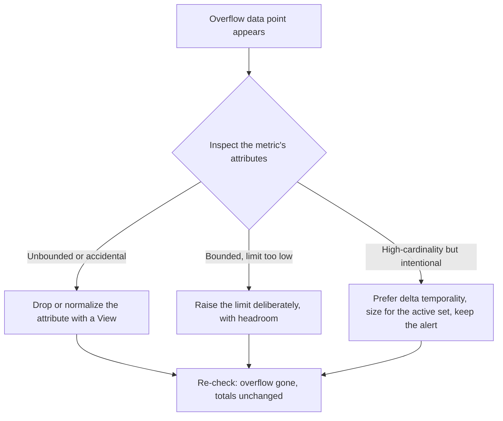

Versions this article targets: Python 3.12, opentelemetry-api and
opentelemetry-sdk 1.45.2, opentelemetry-exporter-prometheus 0.66b2. The
cardinality limit is enforced by the metrics SDK. The Prometheus queries
are quoted from the OpenTelemetry blog post cited in References; Prometheus
3.16.0 (2026-11-04) is the current stable release.

Consider a checkout service that counts every request with two attributes:
the route template and whether the request succeeded. Its error-rate alert
watches the share of measurements with `success=false`, and its dashboard
shows the error rate by route. One deploy changes the instrumentation to
record the raw request path instead of the route template. Nothing else
changes. The next morning the error-rate panel reads zero, and the total
request count is exactly right. The service is still failing checkouts at
the same rate. The alert is not broken. The metric is not broken. The
dashboard is telling the truth about the data it receives, and the data it
receives no longer contains the failures.

OpenTelemetry Python 1.45.2, released 2026-10-29, enforces a cardinality
limit on every metric stream for the first time: 2000 unique attribute
combinations per stream by default. When a stream passes the limit, the
extra combinations are not dropped. They are folded into a single overflow
data point marked `otel.metric.overflow=true`, and the overflow point
carries none of the original attributes. The total stays correct. Every
query that filters or groups by an attribute undercounts, silently, for as
long as the stream overflows.

This guide measures that behavior on the real SDK, shows the three ways to
respond, and shows how to catch overflow in production before a dashboard
misleads you.

> [!NOTE]
> In short
>
> - The Python SDK caps each metric stream at 2000 attribute combinations by
>   default, starting in 1.45.2. The cap is per stream, per process, and it
>   is enforced after View attribute filtering.
> - Overflow folds whole combinations into one data point marked
>   `otel.metric.overflow=true`. Totals stay correct; filtered and grouped
>   queries undercount.
> - Drop the unbounded attribute with a View (`attribute_keys`), or raise
>   the limit deliberately with `View(aggregation_cardinality_limit=...)`
>   or a reader `cardinality_limits` map. Raise the limit only after the
>   attributes are intentional and bounded.
> - Under cumulative temporality the limit counts every combination ever
>   seen, so a growing dimension overflows eventually. Under delta it
>   counts only the active set per cycle.
> - Alert on the overflow label: `count by (__name__, job)
>   (last_over_time({otel_metric_overflow="true"}[5m])) > 0`.

## The model: one stream, one limit

A metric stream is one instrument plus one View. When a measurement is
recorded, the SDK aggregates it by the full set of attribute values. Each
unique combination becomes a separate data point that the SDK tracks in
memory, so cardinality is the memory cost of a metric: it scales with the
number of distinct attribute combinations, not with request volume. A
counter with `http.route` and `success` has one data point per
(route, success) pair. Add a raw path, a user id, or a request id, and the
combinations grow with every distinct value the service ever sees.

The limit exists to bound that memory. The default is 2000 combinations
per metric stream, set by the specification and enforced by the Python SDK
since 1.45.2. Three details of the design matter more than the number:

**Overflow is a fold, not a drop.** When the limit is reached, the SDK
creates the overflow data point before the limit is hit and aggregates
every further combination into it. The overflow point carries exactly one
attribute, `otel.metric.overflow=true`, and none of the original
measurement attributes. The specification guarantees every measurement is
reflected in exactly one aggregator: measurements are never double-counted
and never dropped during overflow. The total is therefore always right,
and the breakdown is the thing that breaks.

**The whole combination goes, not just the bad attribute.** This is the
part worth remembering. If a measurement `{http.route=/checkout,
success=false}` overflows, the overflow point drops `success` along with
`http.route`. A low-cardinality boolean becomes unreliable for filtering
the moment its measurements fold into overflow, even though `success` on
its own is as low-cardinality as an attribute can be.

**Enforcement happens after attribute filtering.** A View that drops the
unbounded attribute keeps the stream under the limit, because the limit is
evaluated on the attributes that survive the View. Configuration follows a
precedence the specification fixes: a matching View's
`aggregation_cardinality_limit` wins, then the reader's default, then the
2000 default. Resource attributes such as `service.name` and
instrumentation scope attributes are not measurement attributes, so the
limit does not apply to them, and they stay attached to every data point,
including the overflow one.

The limit is a process memory guard, not a backend budget. One process
holds at most the configured limit (2000 by default) per stream, but a fleet
of a thousand processes, each exporting different combinations under delta
temporality, can still produce far more backend series. Raising the limit in one process
does nothing about that. The limit also applies to every instrument kind:
counters, histograms, gauges, and asynchronous instruments, not only to
counters.

{: .figure}

## Measuring it

The harness is a request counter with `http.route` and `success`, built on
an in-memory reader so every data point can be inspected directly. The
setup code is the whole experiment:

```python
def make_provider(*, limit=None, keep_attributes=None, temporality=None):
    """Build a MeterProvider with an in-memory reader.

    limit: per-stream cardinality limit, applied through a View.
        None means the SDK default of 2000.
    keep_attributes: attribute keys to keep; every other attribute is
        dropped by a View before aggregation, so it cannot count toward
        the limit. None keeps all attributes.
    temporality: AggregationTemporality.CUMULATIVE (the default) or .DELTA.
    """
    views = []
    if limit is not None or keep_attributes is not None:
        views.append(
            View(
                instrument_name=INSTRUMENT_NAME,
                aggregation_cardinality_limit=limit,
                attribute_keys=keep_attributes,
            )
        )
    reader_kwargs = {}
    if temporality is not None:
        reader_kwargs["preferred_temporality"] = {Counter: temporality}
    reader = InMemoryMetricReader(**reader_kwargs)
    provider = MeterProvider(metric_readers=[reader], views=views)
    return provider, reader
```

Each route is a distinct attribute combination, so the number of routes
recorded is the stream's cardinality:

```python
def record_requests(counter, routes, failures=()):
    """Record one successful request per route, plus the failed ones.

    Each route is a distinct attribute combination, so ``len(routes)``
    is the stream's cardinality before the failures are counted.
    """
    for route in routes:
        counter.add(1, {"http.route": route, "success": "true"})
    for route in failures:
        counter.add(1, {"http.route": route, "success": "false"})
```

The first scenario records 2001 routes against the default limit, plus one
failure on an already-seen route. The failure is a new combination
(`/item/0` with `success=false`), so the stream holds 2002 distinct
combinations against a limit of 2000:

```python
def scenario_default_limit():
    provider, reader = make_provider()
    meter = provider.get_meter("checkout")
    counter = meter.create_counter(INSTRUMENT_NAME)
    routes = [f"/item/{i}" for i in range(DEFAULT_LIMIT + 1)]
    record_requests(counter, routes, failures=["/item/0"])
    points = collect(reader)
    overflow = [p for p in points if is_overflow(p[0])]
    print(f"Default limit ({DEFAULT_LIMIT}), {len(routes)} routes, "
          "1 failure on /item/0:")
    print(f"  data points: {len(points)} "
          f"({len(points) - len(overflow)} regular + {len(overflow)} overflow)")
    print(f"  overflow value: {overflow[0][1]} "
          "(the 2001st route plus the failure, folded together)")
    print(f"  total requests: {total(points)} (correct: 2002 recorded)")
    print(f"  success=false total: "
          f"{filtered_total(points, 'success', 'false')} "
          "(wrong: 1 failure was recorded, the query sees 0)")
    provider.shutdown()
```

```console
Default limit (2000), 2001 routes, 1 failure on /item/0:
  data points: 2001 (2000 regular + 1 overflow)
  overflow value: 2 (the 2001st route plus the failure, folded together)
  total requests: 2002 (correct: 2002 recorded)
  success=false total: 0 (wrong: 1 failure was recorded, the query sees 0)
```

Three facts in that output decide how to think about overflow. The
overflow point holds exactly the two folded measurements, so the total is
2002, the number recorded. The first 2000 combinations observed keep their
own data points; the combinations that arrive after the limit is reached
fold into overflow. And the filtered query returns 0 for a failure that
really happened, because the overflow point does not carry
`success=false`. The tests also confirm the boundary: exactly 2000
combinations produce 2000 points and no overflow, and a histogram overflows
the same way a counter does.

## Three ways to respond

There are three responses, and the order matters: drop, raise, or keep and
monitor. The first is the fix for an accidental attribute. The second is
for a dimension that is intentional and bounded. The third is for a
dimension that is intentional, high-cardinality, and operationally
necessary.

**Drop the attribute.** A View that keeps only `success` collapses the
stream to two combinations, and the filtered query becomes correct again:

```python
def scenario_drop_attribute():
    provider, reader = make_provider(keep_attributes={"success"})
    meter = provider.get_meter("checkout")
    counter = meter.create_counter(INSTRUMENT_NAME)
    routes = [f"/item/{i}" for i in range(DEFAULT_LIMIT + 1)]
    record_requests(counter, routes, failures=["/item/0"])
    points = collect(reader)
    print("View keeps only success (drops http.route):")
    for attrs, value in points:
        print(f"  data point {attrs}: {value}")
    print(f"  total requests: {total(points)} (correct)")
    print(f"  success=false total: "
          f"{filtered_total(points, 'success', 'false')} (correct now)")
    provider.shutdown()
```

```console
View keeps only success (drops http.route):
  data point {'success': 'true'}: 2001
  data point {'success': 'false'}: 1
  total requests: 2002 (correct)
  success=false total: 1 (correct now)
```

Raw paths, user input, request ids, session ids, and unbounded error
messages usually should not be metric attributes at all. Route templates,
status codes, HTTP methods, and bounded error categories usually are safe.
If an attribute is useful for logs or traces but not for aggregation,
remove it from the metric stream with a View, or fix the instrumentation
upstream. The View is the fast fix; fixing the instrumentation is the
durable one when you own it.

**Raise the limit deliberately.** When the dimensions are intentional and
bounded, set the limit from the combinations you expect, with headroom.
For a counter with 100 known routes, 5 methods, and 2 success values, the
stream holds at most 1000 combinations, so a limit above that, with
headroom, is honest sizing:

```python
def provider_with_limit(limit):
    """Build a MeterProvider whose request counter uses the given limit."""
    views = [View(
        instrument_name=INSTRUMENT_NAME,
        aggregation_cardinality_limit=limit,
    )]
    reader = InMemoryMetricReader()
    return MeterProvider(metric_readers=[reader], views=views), reader
```

A limit can also be set per reader for a whole instrument class, as a
mapping from instrument class to limit:

```python
def provider_with_reader_limit(limit):
    """Build a MeterProvider with a reader-level limit for counters.

    The reader limit is a mapping from instrument class to limit, not a
    plain number: passing {"default": limit} raises ValueError.
    """
    reader = InMemoryMetricReader(cardinality_limits={Counter: limit})
    return MeterProvider(metric_readers=[reader]), reader
```

The View limit wins over the reader limit when both are set.

**Keep the dimension and monitor.** Some dimensions are worth their cost.
A service with per-tenant SLOs needs `tenant_id` on a metric to answer
what one tenant's failure rate is; removing the dimension makes the metric
cheaper and less useful. In that case size the limit for the active set,
prefer delta temporality where it fits, and keep the overflow alert in
place. The goal is not to avoid overflow at all costs. The goal is to make
overflow rare, visible, and meaningful.

The Prometheus exporter confirms what the overflow looks like on the wire.
Rendering the exposition format for a stream with a limit of 3 and five
routes shows the overflow series carrying the label
`otel_metric_overflow="true"`, with the folded attributes present as
empty-string labels:

```python
def prometheus_overflow_lines(limit=3, n_routes=5):
    """Render the Prometheus exposition for an overflowing counter.

    Returns the exposition lines for the request counter. Needs
    opentelemetry-exporter-prometheus 0.66b2 and prometheus_client.
    """
    from opentelemetry.exporter.prometheus import PrometheusMetricReader
    from prometheus_client import CollectorRegistry, generate_latest

    registry = CollectorRegistry()
    reader = PrometheusMetricReader(registry=registry)
    provider = MeterProvider(
        metric_readers=[reader],
        views=[View(instrument_name=INSTRUMENT_NAME,
                    aggregation_cardinality_limit=limit)],
    )
    meter = provider.get_meter("checkout")
    counter = meter.create_counter(INSTRUMENT_NAME)
    record_requests(counter, [f"/item/{i}" for i in range(n_routes)])
    text = generate_latest(registry).decode()
    provider.shutdown()
    return [ln for ln in text.splitlines()
            if ln.startswith("http_server_request_count_total{")]
```

The exported overflow series looks like this (scope labels omitted for
readability):

```text
http_server_request_count_total{http_route="/item/0",otel_metric_overflow="",success="true"} 1.0
http_server_request_count_total{http_route="/item/1",otel_metric_overflow="",success="true"} 1.0
http_server_request_count_total{http_route="/item/2",otel_metric_overflow="",success="true"} 1.0
http_server_request_count_total{http_route="",otel_metric_overflow="true",success=""} 2.0
```

Two details matter for anyone writing queries against this. The overflow
series carries the other labels with empty values, so a selector such as
`{success="false"}` never matches it, and a `sum by (success)` puts the
overflowed value under `success=""`. And every regular series carries
`otel_metric_overflow=""`, so the overflow label is present on the whole
metric family and can be selected on directly.

## Temporality decides when the limit bites

The same dimension behaves differently under the two temporalities, and the
difference is the difference between a limit that holds and one that is
guaranteed to break. With delta temporality the SDK resets aggregation
state after each collection cycle, so the limit bounds only the
combinations active within a single cycle. With cumulative temporality the
SDK retains state across cycles, so once the limit is reached, new
combinations keep overflowing until the process restarts.

The harness shows it with a limit of 5: four tenants in cycle 1, four new
tenants in cycle 2.

```python
def scenario_temporality():
    for temporality in (AggregationTemporality.CUMULATIVE,
                        AggregationTemporality.DELTA):
        provider, reader = make_provider(
            limit=5, temporality=temporality)
        meter = provider.get_meter("checkout")
        counter = meter.create_counter(INSTRUMENT_NAME)
        for i in range(4):
            counter.add(1, {"tenant": f"t{i}"})
        cycle1 = collect(reader)
        for i in range(4, 8):
            counter.add(1, {"tenant": f"t{i}"})
        cycle2 = collect(reader)
        overflow = [p for p in cycle2 if is_overflow(p[0])]
        print(f"{temporality.name}: cycle 1 has {len(cycle1)} points, "
              f"cycle 2 has {len(cycle2)} points, "
              f"overflow value {overflow[0][1] if overflow else 0}, "
              f"cycle 2 total {total(cycle2)}")
        provider.shutdown()
```

```console
CUMULATIVE: cycle 1 has 4 points, cycle 2 has 6 points, overflow value 3, cycle 2 total 8
DELTA: cycle 1 has 4 points, cycle 2 has 4 points, overflow value 0, cycle 2 total 4
```

Under cumulative, cycle 2 holds all eight tenants ever seen against a
limit of five, so three fold into overflow. Under delta, cycle 2 holds only
the four tenants active in that cycle, so nothing overflows. The
OpenTelemetry blog works through the same case at production scale: a
service with one million tenants but only 5000 active in a 60-second
collection cycle, recording `tenant_id` and `success`, has about 10,000
active combinations per cycle. A limit slightly above that, with burst
headroom, is reasonable under delta temporality. The same setup under
cumulative temporality accumulates tenants over the process lifetime, so a
dimension that is safe under delta is a guaranteed overflow path under
cumulative.

{: .figure}

The Prometheus reader uses cumulative temporality, which is the default for
most exporters. If you size a limit, size it for the temporality the metric
actually runs under: lifetime combinations for cumulative, the per-cycle
active set for delta. A limit sized for the active set while running
cumulative temporality is the quiet version of mistake three below.

## Failure modes: the three production mistakes

**1. Trusting a filtered breakdown without checking overflow.** What you
see: an error-rate panel drops to zero after a deploy, while the total
request count stays exactly right. The cause: the deploy added an unbounded
attribute, the stream passed 2000 combinations, and the failures folded
into the overflow point, where they no longer carry `success=false`. The
fix: alert on overflow (the query is in Operating it), and check the
overflow label before trusting any breakdown. Overflow usually appears
after a change: a route template stops being applied, an instrumentation
library adds an attribute, a new code path starts recording user input, or
traffic changes in a way that activates many more combinations than usual.
That is also why totals staying correct is dangerous: nothing looks broken.
A dashboard that only shows totals can stay green for weeks while every
filtered panel undercounts, the same way server-side dashboards stayed
green during the [Firebase outage](/posts/firebase-outage-fail-safe-clients/)
while client apps were crashing.

**2. Raising the limit as the first response.** What you see: overflow
disappears, then returns worse; process memory grows; backend series
explode. The cause: the leak is still there. A higher limit only moves the
folding point further out, and the SDK cap is a process memory guard, not a
backend budget, so with delta temporality across a fleet the backend still
receives every combination each process exports. The fix: drop or normalize
the attribute first, then raise the limit only for dimensions that are
intentional and bounded, sized from the combinations you expect. Treat
overflow as a signal to inspect the metric, not as an automatic reason to
raise the limit.

**3. Sizing the limit for the wrong temporality.** What you see: a limit
sized for the per-cycle active set still overflows within days of a deploy.
The cause: the metric runs under cumulative temporality, which counts every
combination the process has ever seen, while the limit was sized for the
combinations active in one cycle. The fix: size for lifetime combinations
under cumulative, and switch to delta only when the active set is bounded
and you understand that delta resets each cycle. Note the asymmetry the
specification allows: under delta, when overflow does happen, the SDK may
choose an arbitrary subset of attribute sets to output, so the surviving
breakdown is not guaranteed to be the first-observed sets the way it is
under cumulative.

Two misunderstandings sit underneath all three mistakes. Overflow does not
mean data was lost: the values are folded into the overflow point, so the
total is correct, and deleting the metric throws away the only signal that
the dimension was wrong. And the overflow point is not a second copy of the
measurements: every measurement lands in exactly one aggregator, so
summing the regular points and the overflow point gives the true total,
never more.

## Proving it works

The shipped tests run against the real SDK 1.45.2 with an in-memory
reader, except the Prometheus test, which renders the exposition format
through a fresh registry. Small limits stand in for the 2000 default so the
mechanism is visible in a handful of measurements; the two default-limit
tests use the real 2000. Run them with:

```bash
python3 -m unittest test_cardinality -v
```

The 15 tests prove the claims this article makes:

- The default limit overflows at the 2001st combination: 2000 regular
  points plus one overflow point, overflow value 2, total 2002. At exactly
  2000 combinations there is no overflow.
- A filtered `success=false` query returns 0 while one failure was
  recorded, and returns 1 once a View drops the route attribute.
- A View with a limit of 5000 removes overflow; a View keeping only
  `success` collapses 2001 routes to two points with the total preserved.
- The limit is enforced after attribute filtering: with only `success`
  kept and a limit of 1, the two surviving combinations still overflow.
- A reader-level limit of `{Counter: 3}` gives three points plus overflow.
- Cumulative temporality accumulates combinations across cycles and
  overflows in cycle 2; delta resets each cycle and does not.
- The first-observed combinations keep their points; the overflow value
  accumulates; no measurement is lost or double-counted.
- A histogram overflows the same way a counter does, and attribute-free
  measurements never overflow.
- The Prometheus exporter renders the overflow series with
  `otel_metric_overflow="true"` and the series sum to the recorded total.

## Operating it

The overflow data point is marked the same way in every SDK, so one query
finds it everywhere. To find metrics that emitted an overflow data point in
the last day, the OpenTelemetry blog gives this query:

```promql
count by (__name__, job) (
  last_over_time({otel_metric_overflow="true"}[1d])
)
```

For each result, inspect the metric's measurement attributes, look for
unbounded ones such as raw paths, ids, or user input, and decide whether
the dimensions are intentional. If they are not, drop or normalize the
offending attribute. If they are, choose a limit using the sizing approach
above. If the query returns nothing, that is a useful baseline, not proof
that all metrics are safe: the SDK may not implement cardinality limits,
the overflow may have happened outside the retention window, or the backend
may not expose the attribute the way you expect.

For continuous monitoring, alert when any metric in any service emits an
overflow data point:

```promql
count by (__name__, job) (
  last_over_time({otel_metric_overflow="true"}[5m])
) > 0
```

Tune the window and grouping labels for your environment, and split the
severity: page when overflow appears on metrics used for paging, SLOs,
autoscaling, or critical dashboards, and ticket when it appears on
exploratory metrics. This matters most for SLOs. A
[multiwindow burn-rate alert](/posts/slos-and-error-budgets-for-one-service/)
built on a filtered SLI undercounts errors the moment the SLI metric
overflows, so the alert that should page stays quiet while the budget
drains. Dashboards should also make overflow visible: if a chart filters or
groups by a measurement attribute, put an overflow indicator beside it, so
readers can tell whether the breakdown is complete or whether some values
were folded into overflow.



## Trade-offs and alternatives

A View is the fast fix, and it is the right place when a library emits the
attribute: you cannot change the library, but you can decide what your
streams keep. Fixing the instrumentation upstream is better when you own
it, because the attribute should never have been recorded on the metric in
the first place. The [tracing guide](/posts/tracing-python-service-opentelemetry/)
makes the same point for spans: high-cardinality values belong in traces
and logs, where one value costs one record, not in metric attributes, where
one value costs a data point held in memory for the life of the process.

Delta temporality bounds the active set, but it resets each cycle, so
rate and ratio calculations that span cycles need care, and the surviving
breakdown under overflow is not guaranteed to be first-observed. Cumulative
temporality keeps every combination ever seen, which is why it is the
default for Prometheus and why its limits must be sized for a lifetime, not
a cycle. Neither temporality bounds backend cardinality on its own: a fleet
of processes under delta still exports the union of their active sets.

When not to raise the limit: never to hide a leak, never for raw URLs,
request ids, or unbounded error messages, and never without recording the
sizing next to the View so the next engineer can see why the number is
what it is. A limit that is too low causes overflow for valid dimensions
and makes filtered queries unreliable. A limit that is too high weakens the
safety net, and some SDKs may also allocate more memory as the configured
limit increases.

Recommendation: leave the 2000 default alone for most streams. Treat the
first overflow as a bug report about an attribute, fix the attribute, and
only then consider a deliberate limit for a dimension you chose on purpose.

## Checklist

- [ ] Every metric attribute is bounded: no raw paths, user ids, request
      ids, or free-form error messages.
- [ ] A View drops any attribute that is only useful in traces or logs.
- [ ] The overflow alert is in place for every service that exports
      metrics, paging for SLO and autoscaling metrics.
- [ ] Each raised limit is sized from the combinations the stream should
      hold, with headroom, and the sizing is recorded next to the View.
- [ ] SLO and paging queries are checked against the overflow label after
      any instrumentation change.
- [ ] Temporality is explicit: cumulative limits are sized for lifetime
      combinations, delta limits for the per-cycle active set.
- [ ] After a deploy that touches instrumentation, the overflow query is
      checked within a day.

## References

- OpenTelemetry, [Metric cardinality limits in OpenTelemetry: a practical guide](https://opentelemetry.io/blog/2026/cardinality-limits-in-opentelemetry/) (2026-08-06)
- [OpenTelemetry Metrics SDK: Cardinality limits](https://opentelemetry.io/docs/specs/otel/metrics/sdk/#cardinality-limits)
- OpenTelemetry, [Metrics](https://opentelemetry.io/docs/concepts/signals/metrics/#cardinality-limits) (Cardinality limits section)
- OpenTelemetry Python, [Release 1.45.2](https://github.com/open-telemetry/opentelemetry-python/releases/tag/v1.45.2)
