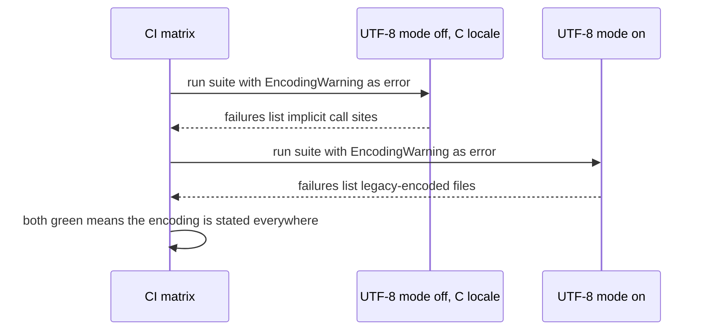

Versions this article targets: Python 3.15, released 9 October 2026.
The code was measured on Python 3.12.3 in this run by toggling UTF-8
mode, the exact mechanism PEP 686 makes the default in 3.15. No
Python 3.15 interpreter was available in this environment, so every
claim about 3.15 itself is cited to the official docs below, not
claimed as measured on 3.15. The shipped code runs unchanged on 3.12
and on 3.15.

A service reads a configuration file, a data export, or a log file
with a plain `open(path)`. On the developer machine it works. On a
Windows worker, or on a Linux worker running under the C locale, the
same call raises `UnicodeDecodeError` on the first non-ASCII byte, or
worse, reads the file as mojibake and carries on. Nothing about the
file changed. The interpreter's default encoding changed underneath
the call.

That is the Python 3.15 change, in one sentence: PEP 686 makes UTF-8
mode the default, so `open()` without an `encoding` argument now uses
UTF-8 on every platform instead of the locale encoding. The What's
New page states it plainly: "Python now uses UTF-8 as the default
encoding, independent of the system's environment. This means that
I/O operations without an explicit encoding, for example,
`open('flying-circus.txt')`, will use UTF-8." It also gives the one
rule that makes code safe on every version: pass an explicit
`encoding` argument.

The trap is where the breakage shows up. PEP 686 itself says the
change "mostly affects Windows users", because most Unix systems
already use a UTF-8 locale. A team that develops on UTF-8 Linux, runs
its tests on UTF-8 Linux, and deploys to a Windows service or a
C-locale container will see green tests and a broken upgrade. The
fix is not to learn the new default and move on. The fix is to remove
the dependency on any default: find every call site that relies on
one, state the encoding, and prove the suite passes under both modes.

> [!NOTE]
> - On Python 3.15, a bare `open()` reads UTF-8, whatever the locale says. On earlier versions it reads the locale encoding.
> - Find every implicit encoding first: run the suite with `-W error::EncodingWarning` and run the shipped AST scanner over the tree.
> - Fix with an explicit encoding: `encoding="utf-8"` for files your system owns or exchanges, `encoding="locale"` for files that genuinely belong to the local platform.
> - Verify under both modes in CI: UTF-8 mode on and off, plus a C-locale run. A suite that only passes in one mode has not proven anything.
> - Never ship `PYTHONUTF8=0` as the fix, and never silence a decode failure with `errors="replace"`. Both hide the problem the upgrade exposed.

## The default is not a property of the file

A text file is bytes. It does not carry its encoding in a header
that `open()` reads; the call site decides how to decode those bytes,
and when the call site says nothing, the interpreter decides. Before
3.15 that decision was the locale encoding: the encoding of the
operating system's locale, which on Windows is the ANSI code page
and under a C locale is ASCII. From 3.15 it is UTF-8, always, because
UTF-8 mode is on by default. PEP 540 defined that mode back in Python
3.7: when it is active, `open()` uses UTF-8 regardless of locale,
while keeping the `strict` error handler for files. That strictness
matters: a file opened with the wrong encoding fails loudly instead
of guessing. Standard streams are the exception, not the rule: in
UTF-8 mode, `stdin` and `stdout` use the `surrogateescape` error
handler, so do not take their behaviour as evidence about files.

An explicit `encoding` argument bypasses the whole question. It
behaves the same on 3.12, 3.14 and 3.15, on Windows and on Linux.
That is why the What's New page recommends it "for best
compatibility between versions of Python", and why this article's
advice is not "upgrade and hope" but "make every call site explicit,
then upgrade".

 follows the interpreter's default; an explicit encoding states the choice."){: .figure}

The figure shows the two defaults and the escape from both. The
rest of this article is about the two failure directions the figure
implies: a UTF-8 file read under a non-UTF-8 default, and a legacy
file read under the new UTF-8 default. Both are the same bug, seen
from opposite sides: the code trusted a default it never stated.

## The same bytes, three decodings

Take the word café, written as UTF-8 bytes `63 61 66 C3 A9` plus a
newline. Decoded as UTF-8 it reads correctly. Decoded as ASCII, the
byte `C3` is out of range and Python raises `UnicodeDecodeError`.
Decoded as cp1252, the Windows Western European code page, the two
bytes become two separate characters and the text reads as mojibake
with no error at all. The bytes never changed. Only the decoder did.

{: .figure}

That third row is the dangerous one, and it is the reason PEP 686
warns that the change "may cause UnicodeError, mojibake, or even
silent data corruption". A loud error is a bug report. Mojibake is a
corrupted export, a wrong name in a report, or a broken key in a
downstream system, discovered by a customer instead of a test. Any
fix that converts the second row into the third row, by adding
`errors="replace"` or `errors="ignore"`, has made the system worse
while making the test suite greener. Keep the strict handler, and
fix the encoding instead.

## Measuring both modes on one interpreter

The shipped `modes.py` runs the two modes side by side. It writes
two fixtures, one UTF-8 and one cp1252, then reads each one in a
child process under each mode. The child is the only place a bare
`open()` appears, and it appears inside a string, because the bare
call is the behaviour under test. The old mode is a C locale with
locale coercion disabled and `-X utf8=0`; the new mode is
`-X utf8=1`, the Python 3.15 default. Here is the function that
runs one mode:

```python
def read_under_mode(path, utf8_mode):
    """Read ``path`` with a bare open() under one UTF-8 mode.

    ``utf8_mode`` True means ``-X utf8=1`` (the Python 3.15 default);
    False means ``-X utf8=0`` with a C locale and locale coercion
    disabled (the pre-3.15 behaviour under a non-UTF-8 locale).
    Returns a dict with ``preferred``, ``utf8_mode``, ``text`` and
    ``error`` (the error class name, or None).
    """
    env = dict(os.environ)
    env["LC_ALL"] = "C"
    env["PYTHONCOERCECLOCALE"] = "0"
    env.pop("PYTHONUTF8", None)
    env.pop("PYTHONIOENCODING", None)
    flag = "utf8=1" if utf8_mode else "utf8=0"
    proc = subprocess.run(
        [sys.executable, "-X", flag, "-c", CHILD, str(path)],
        env=env,
        capture_output=True,
        text=True,
        encoding="utf-8",
        check=True,
    )
    return json.loads(proc.stdout.strip().splitlines()[-1])
```

Two details in that function are load-bearing, and both are easy to
get wrong when reproducing the experiment by hand. First, setting
`LC_ALL=C` alone is not enough on modern Python: locale coercion
(PEP 538) silently upgrades a C locale to C.UTF-8, so the old mode
never appears unless `PYTHONCOERCECLOCALE=0` is also set. Second,
`PYTHONUTF8` and `PYTHONIOENCODING` are removed from the child's
environment, so a developer's shell cannot leak a mode into the
measurement. Running `python3 modes.py` on Python 3.12.3 prints:

```console
old mode: preferred=ANSI_X3.4-1968 utf8_mode=False utf8_bytes -> None error=UnicodeDecodeError
old mode: legacy_bytes -> None error=UnicodeDecodeError
new mode: preferred=utf-8 utf8_mode=True utf8_bytes -> 'café\n' error=None
new mode: legacy_bytes -> None error=UnicodeDecodeError
explicit utf-8 under old mode: café
explicit cp1252 under new mode: café
```

Read that output as a table, not as a story. Under the old mode,
the UTF-8 file fails and the legacy file fails too, because ASCII
decodes neither. Under the new mode, the UTF-8 file reads and the
legacy file fails, because UTF-8 decodes cp1252 bytes only by
accident and here it does not. The explicit rows are the point:
`encoding="utf-8"` reads the UTF-8 file under the old mode, and
`encoding="cp1252"` reads the legacy file under the new mode. An
explicit encoding is the only row that does not move when the
default moves.

One more measurement note, because it decides how to read the
output. Under the new mode, `locale.getpreferredencoding(False)`
reports UTF-8 even though the locale is C. That is UTF-8 mode
working as specified, not a bug, but it means code that branches
on `getpreferredencoding()` to discover the platform encoding will
get the wrong answer on 3.15. Code that genuinely needs the locale
encoding should use `locale.getencoding()`, added in Python 3.11,
which ignores UTF-8 mode. The scanner flags the old call for exactly
this reason.

## Finding every implicit encoding

There are two ways to find the call sites, and they catch different
things, so use both. The first is the interpreter's own warning.
`EncodingWarning` fires when a text file is opened without an
encoding argument, and it is opt-in: run the suite with
`-W error::EncodingWarning` (or set `PYTHONWARNDEFAULTENCODING=1`)
and every implicit call becomes a test failure with a file and line.
That catches runtime paths, including `TextIOWrapper` and
`subprocess` text mode, which a static scan cannot see. It misses
any path the tests never execute, which is why the second tool
exists.

The shipped `find_implicit.py` walks a tree with the `ast` module
and reports `open()`, `io.open()`, `Path.open()`,
`Path.read_text()` and `Path.write_text()` calls with no `encoding`
keyword, plus `locale.getpreferredencoding()` calls. Binary mode
is not flagged, because the default encoding does not apply to it.
A call whose mode is a variable is not flagged either: the scanner
cannot prove such a call is text, and a tool that cries wolf gets
ignored. Those two limitations are documented in the file, and the
warning flag is the backstop for both. The core of the scanner is
one function:

```python
def scan_file(path):
    """Return the findings for one file; [] for an unparseable file."""
    source = Path(path).read_text(encoding="utf-8")
    try:
        tree = ast.parse(source, filename=str(path))
    except SyntaxError as exc:
        print(f"warning: skipping unparseable file {path}: {exc}", file=sys.stderr)
        return []
    visitor = _Visitor(str(path))
    visitor.visit(tree)
    return visitor.findings
```

Run it over a tree and it exits 1 with one line per finding, or 0
when the tree is clean:

```console
$ python3 find_implicit.py src/
src/ingest.py:42: implicit-encoding: open() without encoding= relies on the default encoding
src/ingest.py:87: implicit-encoding: Path.read_text() without encoding= relies on the default encoding
```

Note what the scanner does not do: it accepts any explicit
encoding, including `encoding="locale"`. The goal is a stated
choice, not a mandated one. The next section decides which stated
choice each call site deserves.

{: .figure}

## Fixing each call site

Work through the scanner's list in three buckets. The bucket, not
the file type, decides the encoding.

First, files your system owns or exchanges: source files, JSON,
TOML, Markdown, CSV exports your code writes and reads back, and
anything that crosses a service boundary. These get
`encoding="utf-8"`, unconditionally. UTF-8 is the encoding of the
formats themselves, and it is now the interpreter's default, so
this choice agrees with 3.15 and survives any future default change
in the same direction. Write it even where it is currently
redundant: redundancy here is the documentation.

```python
with open(path, encoding="utf-8") as f:
    data = f.read()
```

Second, files that genuinely belong to the local platform: a log
written by a Windows tool in the ANSI code page, a legacy export
from a system that writes in the machine's locale. These get
`encoding="locale"`, which has been supported since Python 3.10
and, since the fix PEP 686 required in 3.11, really does mean the
locale encoding even in UTF-8 mode. Prefer naming the real legacy
encoding when you know it, `encoding="cp1252"` for a known
Windows export, because `locale` still moves with the machine.
`locale` is the honest choice only when the file's encoding truly
is "whatever this machine uses".

Third, the call sites that are not files at all: `sys.stdin` and
`sys.stdout` in text mode, and `subprocess` with `text=True`. In
UTF-8 mode these use UTF-8 with `surrogateescape`, which round-trips
undecodable bytes through surrogates instead of failing. If a
pipeline stage decodes stdin, transforms the text, and re-encodes
it, surrogates can leak into output or into a strict encoder
downstream. State the encoding on these too, or switch the stage
to bytes and decode once, explicitly, at the boundary.

## Failure modes

| What the reader sees | Cause | Fix |
| :--- | :--- | :--- |
| `UnicodeDecodeError` on the first non-ASCII byte after upgrading | A UTF-8 file read under a non-UTF-8 default, or a legacy file read under the new UTF-8 default | State the file's real encoding at the call site; do not change the error handler |
| Mojibake in exports, names, or keys, with no error | A legacy file decoded as UTF-8, or UTF-8 bytes decoded as a single-byte encoding | Find the call site with the scanner, state the encoding, and add a test with non-ASCII fixture bytes |
| Tests pass locally, the upgrade fails in production | The suite only ever ran under a UTF-8 locale, so the old default and the new default agreed on every fixture | Run CI under both modes and under a C locale, with non-ASCII fixtures |
| `locale.getpreferredencoding()` returns UTF-8 on a non-UTF-8 machine | UTF-8 mode makes that function report UTF-8 by design | Use `locale.getencoding()` when the code needs the real locale encoding |
| A fix that works for `open()` but not for `Path.read_text()` | The scanner list was worked through partially, or the warning flag only covered executed paths | Work the whole scanner list, and gate CI on both the warning flag and the scanner |

The three production mistakes behind that table are worth naming
separately, because each one looks like a reasonable shortcut.

Mistake one: treating the upgrade as a no-op because the tests
pass. On a UTF-8 Linux machine, the old default and the new default
are the same string for UTF-8 files, so a suite with only ASCII
fixtures, or only UTF-8 fixtures, cannot distinguish them. The
breakage is not in the code the tests cover; it is in the
deployment the tests never model. A loud error beats silent
corruption, and the same lesson runs through the earlier
[fail-safe clients](/posts/firebase-outage-fail-safe-clients/) case
study: a system that trusts an unstated input fails at the worst
possible boundary.

Mistake two: shipping `PYTHONUTF8=0` as the fix. It works, in the
narrow sense that it restores the old default for one process. It
also hides every call site that still depends on that default,
applies to libraries as well as application code, and re-breaks
the moment the flag is forgotten in one deployment, one container
image, or one cron job. PEP 686 provides the flag as a bridge, not
as a destination. Use it to buy a week while the scanner list is
worked through, with an expiry date, not as a permanent setting.

Mistake three: fixing `open()` and stopping there. `Path.read_text()`
and `Path.write_text()` take the same default, `io.TextIOWrapper`
does too, and `subprocess` text mode follows the same rule. A
codebase that fixes only the calls spelled `open` still has
implicit encodings, and the warning flag is the only tool that
sees the ones the scanner cannot. Retrying the read does not help
either: the bytes and the decoder have not changed, so a
[retry](/posts/retries-with-exponential-backoff-and-jitter/) just
raises the same error again, faster.

## Proving it works

The shipped suite has 20 tests, all passing on Python 3.12.3 with
deprecation warnings as errors:

```console
$ python3 -W error::DeprecationWarning -m unittest test_encoding -v
Ran 20 tests in 0.5s
OK
```

The mode tests assert the measured contrast: under the old mode
the preferred encoding is ASCII and a UTF-8 file raises
`UnicodeDecodeError`; under the new mode the preferred encoding is
UTF-8 and the same file reads as café, while a cp1252 file raises.
The explicit-encoding tests assert the fix: `encoding="utf-8"`
reads the UTF-8 file under the old mode, and `encoding="cp1252"`
reads the legacy file under the new mode. The scanner tests assert
both directions of the tool: bare `open()`, `Path.open()` and
`Path.read_text()` without an encoding are found; binary mode,
explicit `utf-8`, explicit `locale`, and a variable mode are not
flagged; `getpreferredencoding()` is flagged; an unparseable file
is skipped with a warning instead of crashing the scan; and the
command line exits 1 on findings and 0 when clean.

Run the same suite on the target version before declaring the
upgrade done, and run it twice: once with UTF-8 mode on, once with
it off. The suite's own code uses explicit encodings everywhere, so
it passes under both, which is itself a check on the discipline
this article recommends.

## Operating it

An encoding upgrade is a rollout, not a version bump. Ship it in
this order. First, land the explicit-encoding fixes on the current
interpreter, with no interpreter change, and let them ride one
release. Nothing about that change can break a reader that already
worked, because an explicit encoding that matches the file's real
encoding decodes exactly what the default decoded. Second, flip the
interpreter in staging with the CI matrix below, and read the
failures as a list of call sites, not as a reason to roll back the
flag. Third, flip production, and keep `PYTHONUTF8=0` out of the
runbook except as a documented, time-boxed rollback step.



The exact operating signals are three, and none of them is "watch
the logs". One: the CI job that runs the suite with
`-W error::EncodingWarning` fails on any new implicit call, so a
regression is a build failure, not a ticket. Two: the scanner runs
in CI over changed files, or over the whole tree, and fails the
build on any finding, so a call site cannot be added silently.
Three: the matrix runs under both modes and under a C locale, so a
fixture that only passes in one mode is caught before it reaches
production. For the tracing side of a rollout, the earlier guide to
[tracing a Python service](/posts/tracing-python-service-opentelemetry/)
covers the same discipline applied to spans: name the operation,
state the conventions, and keep unbounded values out.

If a failure does reach production, the signal to look for is a
`UnicodeDecodeError` in a reader, or mojibake in an export. The
first is good news: the strict handler did its job. The second
means a call site is still implicit and a legacy file is being
decoded as UTF-8, or vice versa. In both cases the fix is the same
one-line change at the call site, not a process-wide flag.

## Trade-offs and alternatives

Staying on Python 3.14 is a legitimate alternative, and for a
codebase with a large legacy-file surface it may be the right one
for a quarter. It is not a permanent answer: 3.14 will reach end of
life, and the default will still be UTF-8 when the team eventually
moves. Treat a stay as a scheduled migration with a date, not as a
decision to ignore the change.

Setting `PYTHONUTF8=0` everywhere is the cheapest alternative and
the worst one, for the reasons in the failure modes: it is
process-wide, it hides the call sites, and it is one forgotten
environment variable away from re-breaking. It has exactly one
good use, as a rollback step during the upgrade window.

Rewriting every legacy file to UTF-8 at ingestion is the most
thorough alternative, and for a data pipeline it is often the right
one: decode once, explicitly, at the boundary, and store UTF-8
from then on. It costs a migration for each legacy source, and it
does not help for files that another system keeps writing in a
legacy encoding. Where the source keeps writing legacy bytes, an
explicit legacy encoding at the reader is the correct permanent
state, not a temporary workaround.

The recommendation, then, is the boring one: state every encoding,
verify under both modes, and then upgrade. The work is a scanner
run and a list of one-line fixes, not a redesign. The risk of
skipping it is also boring, in the worst sense: a service that
works everywhere its developers test it and fails where its users
run it.

## Checklist

- [ ] Run the suite with `-W error::EncodingWarning` and fix every failure, not just the first one.
- [ ] Run `find_implicit.py` over the tree and work the whole list, including `Path.read_text()` and `Path.write_text()`.
- [ ] Give interchange files `encoding="utf-8"`, and give genuinely locale-owned files `encoding="locale"` or their real legacy encoding.
- [ ] Replace `locale.getpreferredencoding()` with `locale.getencoding()` wherever the code needs the real locale encoding.
- [ ] Add a non-ASCII fixture to every reader test: a UTF-8 file and, where legacy files exist, a legacy-encoded file.
- [ ] Run CI under UTF-8 mode on and off, plus a C-locale run with locale coercion disabled, and gate on both the warning flag and the scanner.
- [ ] Keep `PYTHONUTF8=0` out of permanent configuration; if it is used as a bridge, give it an expiry date and an owner.

## References

- Inada Naoki, [PEP 686: Make UTF-8 mode default](https://peps.python.org/pep-0686/)
- [What's new in Python 3.15](https://docs.python.org/3.15/whatsnew/3.15.html)
- Victor Stinner, [PEP 540: Add a new UTF-8 Mode](https://peps.python.org/pep-0540/)
