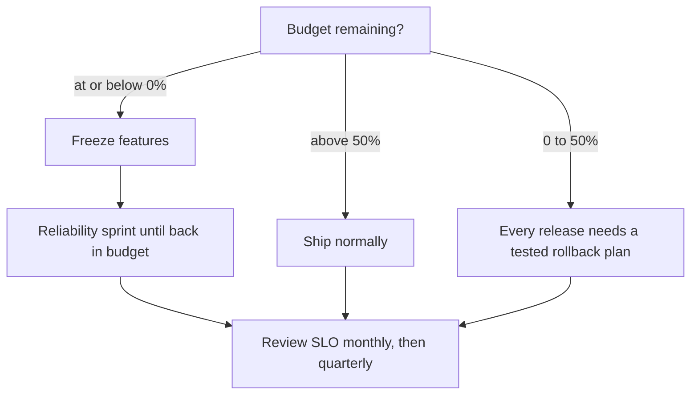

Your pager goes off at 03:00 because the checkout error rate crossed 0.1% for ten minutes. You look, you find nothing, you silence it. By morning there have been eleven more just like it, and the service met its SLO anyway: those wobbles spent 0.02% of the month's error budget each. Meanwhile, three weeks later, a deploy that raises the error rate from 0.05% to 0.35% never pages at all. It is a slow burn, 3.5 times the budget rate, and it eats the entire 30-day budget in under nine days while every alert stays quiet.

Both failures come from alerting on the wrong thing. An error rate is a speed; what you care about is how much of the month's budget it consumes. Google's SRE Workbook has the fix, and it has been stable for years: alert on burn rate, the error rate divided by the budget rate, over two windows at once. This guide builds one service's SLO from the indicator to the budget to the alert rules, with a simulator that proves each rule fires on the right incident and stays quiet on the wrong one. The code is in [slo.py](slo.py), the tests in [test_slo.py](test_slo.py), and the generated alert rules in [prometheus-rules.yaml](prometheus-rules.yaml).

Versions this article targets: Python 3.12 (standard library only, for the simulator), Prometheus 3.15.1 (released 2026-10-21; run it, not 3.15.0, it is a security release), and Sloth 0.16.0 (2026-04-04) for generating the rules. The SRE Workbook chapters cited below are current as of 2026-11-05.

> [!NOTE]
> **In short**
> - An SLO is a target for a ratio of good events to total events. The error budget is `100% - SLO`: for 99.9% over 30 days, 0.1% of all events, or 43.2 minutes of total outage.
> - Burn rate is the error rate divided by the budget rate. A burn rate of 1 spends exactly the budget over the window; 14.4 spends 2% of it in one hour.
> - Page on burn rate over two windows, not on the error rate: 14.4x over 1 hour and 5 minutes pages, 6x over 6 hours and 30 minutes pages, 1x over 3 days and 6 hours opens a ticket.
> - Never use `for:` duration to fake a longer window: flapping errors reset the timer while consuming a third of the budget.
> - A budget with no policy is a KPI. Agree in advance what happens at 50% and at 0%, and who does it.

## The budget behind the nines

Pick one service and one thing its users care about. For checkout, that is: a request succeeds. The service level indicator (SLI) is the ratio of successful requests to total requests, measured over a rolling 30 days. The service level objective (SLO) is the target for that ratio: 99.9%. The error budget is what is left over: 0.1% of all requests in the window may fail. For a service that is either fully up or fully down, that budget in minutes of total outage is:

| SLO (30 days) | Budget rate | Full-outage minutes |
| :--- | :--- | :--- |
| 99% | 1% | 432 (7.2 hours) |
| 99.9% | 0.1% | 43.2 |
| 99.95% | 0.05% | 21.6 |
| 99.99% | 0.01% | 4.32 |

A 99.9% SLO gives you 43 minutes a month. A single 20-minute outage costs 46% of it. The simulator computes this in [slo.py](slo.py) as `full_outage_budget_minutes`, and the tests check all four rows. Note what the budget is not: it is not 43 minutes of *scheduled* downtime you can spend however you like. It is the total failure allowance, and every failed request spends some of it, including the ones your baseline error rate produces every day.

The workbook's first warning is about the target itself: 100% reliability is the wrong target. Some failures always coincide, your customers' chain of systems is longer than yours, and a 100% SLO means you can never change anything, because change is the number one source of outages. An SLO below 100% is what lets you ship. The budget is the price of shipping, stated in advance.

There are two ways to watch the budget drain, and they answer different questions, so say which one a number uses. The rolling-window fraction compares bad events against the budget rate times the events *actually seen* in the window: at a steady 0.05% error rate against a 99.9% SLO it sits at 50% all month, because you are spending exactly half the budget as you go. The cumulative balance compares bad events so far against the budget the month's *expected* traffic allows, and that one falls linearly: 1.67% a day at a 0.05% baseline, then a cliff when an incident lands. Dashboards show the balance; the simulator has both, as `budget_remaining_fraction` and `budget_balance`.

{: .figure}

The figure is the demo month, run by [demo.py](demo.py): 10,000 requests a minute, a 0.05% baseline, a 20-minute outage on day 10, a 6-hour slow burn on day 20, and 30 minutes of flapping errors on day 25. The baseline spends half the budget by day 30. The outage takes 46.3% in 20 minutes, the slow burn 2.9%, the flapping 34.7%. The month ends 33.5% overdrawn, which is exactly the state the policy section is for.

## Burn rate: the speedometer

If the budget is a bank balance, burn rate is the speed at which you are spending it: the error rate divided by the budget rate. A 99.9% SLO has a budget rate of 0.1%, so an error rate of 0.1% is a burn rate of 1, an error rate of 1.44% is 14.4, and a total outage is 1,000. The table below is the workbook's Table 5-4, recomputed by the simulator:

| Burn rate | Error rate (99.9% SLO) | Time to exhaust the budget |
| :--- | :--- | :--- |
| 1 | 0.1% | 30 days |
| 2 | 0.2% | 15 days |
| 10 | 1% | 3 days |
| 100 | 10% | 10.4 hours |
| 1,000 | 100% | 43 minutes |

{: .figure}

Burn rate is what makes alerting precise. Alerting on the error rate cannot distinguish a 0.2% wobble that spends 0.02% of the budget in ten minutes from a 0.35% slow burn that spends the whole budget in nine days: both are "above 0.1%". Alerting on burn rate can, because burn rate already contains the SLO.

## The alert rules

The workbook's recommended starting point for a 99.9% SLO is three rules, each with a long window and a short window. The long window decides whether the spend is significant; the short window, one twelfth of the long one, decides whether the service is *still* burning, so the alert stops soon after the errors stop.

| Severity | Long window | Short window | Burn rate | Budget consumed |
| :--- | :--- | :--- | :--- | :--- |
| Page | 1 hour | 5 minutes | 14.4 | 2% |
| Page | 6 hours | 30 minutes | 6 | 5% |
| Ticket | 3 days | 6 hours | 1 | 10% |

The numbers are not arbitrary: 2% of a 30-day budget spent in one hour is a burn rate of 0.02 × 720 = 14.4; 5% in six hours is 0.05 × 120 = 6; 10% in three days is 0.1 × 10 = 1. The rule fires only when the error rate over *both* windows exceeds the threshold. In code, from [slo.py](slo.py):

```python
@dataclass(frozen=True)
class AlertRule:
    label: str
    long_window_min: int
    short_window_min: int
    burn: float
    severity: str  # "page" or "ticket"

    def fires(self, log, target, now) -> bool:
        threshold = self.burn * (1.0 - target)
        return (
            log.window_error_rate(self.long_window_min, now) > threshold
            and log.window_error_rate(self.short_window_min, now) > threshold
        )


WORKBOOK_RULES_999 = (
    AlertRule("fast-burn-page", 60, 5, 14.4, "page"),
    AlertRule("medium-burn-page", 360, 30, 6.0, "page"),
    AlertRule("slow-burn-ticket", 4320, 360, 1.0, "ticket"),
)
```

The generated Prometheus rules are in [prometheus-rules.yaml](prometheus-rules.yaml), produced by `python3 slo.py` from the same constants, so the file cannot drift from the table above:

```yaml
- alert: SloBudgetBurnPage
  expr: (
        job:slo_errors_per_request:ratio_rate1h{job="checkout"} > (14.4*0.001)
      and
        job:slo_errors_per_request:ratio_rate5m{job="checkout"} > (14.4*0.001)
      ) or (
        job:slo_errors_per_request:ratio_rate6h{job="checkout"} > (6.0*0.001)
      and
        job:slo_errors_per_request:ratio_rate30m{job="checkout"} > (6.0*0.001)
      )
```

Two details in that YAML deserve attention. First, the recording rules are ratios of sums: `sum(rate(errors)) / sum(rate(total))` over the window, never an average of per-minute ratios. A minute with 10 requests and 10 failures weighs the same as a minute with 1,000 requests and 0 failures in an average of ratios, which reports 50% while the true rate is under 1%. Second, one incident fires all three rules at once: a total outage pages after 1 minute on the fast rule, 2 minutes on the medium rule, and 3 minutes on the ticket rule. Route them so the human gets one notification, not three: page on the fast or medium rule, and inhibit the ticket while a page is firing.

The short window earns its place after the incident ends. Take a 15% error spike that lasts ten minutes: the fast rule fires at minute 6, once the 1-hour average crosses 1.44%, and the 5-minute window is clean by minute 15, so the page stops. Without the short window, the 1-hour average stays above 1.44% until minute 65, and the page keeps firing for nearly an hour after the service recovered.

{: .figure}

## Three production mistakes

The three mistakes below are the ones the workbook's alerting chapter is written to prevent. Each has a test in [test_slo.py](test_slo.py) that reproduces it against the simulator.

| Mistake | What the reader sees | Cause | Fix |
| :--- | :--- | :--- | :--- |
| Alerting on the raw error rate | Pages on noise, or silence during a slow burn | The error rate has no SLO in it: 0.2% for 10 minutes spends 0.02% of budget, while 0.35% sustained spends it all in 9 days | Alert on burn rate over two windows |
| Using `for:` duration as a window | Spikes that eat a third of the budget never page | One clean minute resets the duration timer | Use a long window in the expression, not a duration clause |
| An SLO with no policy | A budget number nobody acts on | The SLO is a KPI until someone agrees what happens at 0% | A written policy, agreed before the incident |

**Mistake 1: alerting on the raw error rate.** The trivial rule is `error rate over 10 minutes >= 0.1%`. It fires on a 0.2% wobble that spends 0.02% of the budget, and the workbook works out that you could receive up to 144 such alerts a day, act on none of them, and still meet the SLO. The recall failure is the mirror image: a single burn-rate alert set to page at 36x never fires on a 35x burn, which consumes the whole 30-day budget in 20.5 hours. The burn-rate rules fix both directions: the fast rule needs 2% of budget in an hour, which a 10-minute wobble cannot spend, and the ticket rule catches the 3.5x burn after about 21 hours of sustained errors, when the 3-day average crosses 0.1%.

**Mistake 2: using `for:` duration to fake a longer window.** Prometheus lets you write `error rate > 0.1% for: 1h`, which looks like a one-hour window but is not one. The duration timer resets the moment the rate dips below threshold, even for one minute. A service that fails completely for 5 minutes in every 10 never pages: each clean gap resets the hour. The workbook's Figure 5-3 puts numbers on it: three such spikes consume 35% of the budget, and the alert never fires. The simulator reproduces it exactly: the `ForDurationAlert` never fires across 30 minutes of flapping, while the budget balance falls 34.7%, and the multiwindow fast rule pages 1 minute into the first spike. Put the window in the expression, where the rate is computed over the whole window, and let the short window handle the reset.

**Mistake 3: publishing an SLO with no error-budget policy.** An SLO without a policy is a dashboard number. The workbook's test for whether an SLO is fit for purpose is whether three parties agree to enforce the policy: the SREs, who must find the SLO defensible without heroic toil; the development team and product manager, who must accept the reliability work the policy demands; and the product manager again, who must find the SLO tight enough that users are not badly served before the policy acts. If they do not all agree, iterate on the SLI and SLO until they do. The policy itself is short: above 50% of budget, ship normally; below 50%, every release needs a tested rollback plan; at or below zero, features freeze and the team works reliability until the service is back in budget. The demo month ends at -33.5%, in a freeze, which is the policy working as designed: the freeze is the consequence the budget exists to trigger.

Two more failure modes belong in the same section because they break the same rules in specific conditions. **Low-traffic services** break burn-rate alerting by having too little signal: a service receiving 10 requests an hour has a budget of 7.2 failed requests in 30 days, so one failure is a 10% hourly error rate, a 100x burn, and 13.9% of the budget, and all three rules page on it. (The workbook prints 1,000x for this case; the arithmetic from its own 10% figure gives 100x, and the simulator agrees with the arithmetic. State the window when you quote a burn rate.) The fixes, in the workbook's order: generate synthetic traffic, aggregate smaller services that share a failure mode, make single failures less harmful with [exponential backoff and jitter](/posts/retries-with-exponential-backoff-and-jitter/) and fallback paths, or lower the SLO to match the real impact of one failure. **Extreme availability goals** break the rules the other way. At a 90% SLO, a total outage consumes only 1.4% of the budget in an hour, below the 2% the fast page rule needs, so the rule can never fire: retune the windows. At 99.999%, a total outage exhausts the budget in 26 seconds, faster than most alert pipelines can deliver a page: no alerting configuration defends that SLO, only design that makes a total outage nearly impossible, such as canarying a change to 1% of users so the same burn takes 43 minutes to exhaust the budget.

## Proving it works

The tests, 25 of them in [test_slo.py](test_slo.py), run in under a second with `python3 -W error::DeprecationWarning -m unittest test_slo -v`. They prove the claims the article makes, each against the simulator rather than by assertion:

- The fast rule fires at minute 6 of a 15% spike, not minute 5, when the 1-hour average crosses 1.44%; it stops 5 minutes after the errors stop, while the 1-hour average is still above threshold.
- The slow burn (0.35% sustained) never pages, and tickets after about 21 hours.
- The flapping spikes never fire a `for: 1h` alert while consuming 34.7% of the budget, and do fire the multiwindow page.
- The low-traffic case: one failure in 10 requests an hour is a 100x burn and 13.9% of budget.
- The ratio-of-sums trap: 10 bad in 1,010 total is 0.99%, while the average of per-minute ratios says 50%.

The demo, [demo.py](demo.py), runs the full month and prints the daily balance, the policy at each day boundary, and the first firing minute of each rule for each incident. Its output is the source of the budget-drain figure and the policy numbers above.

## Operating it

Four things, named, no "monitor appropriately". First, the recording rules: `job:slo_errors_per_request:ratio_rate1h`, `ratio_rate5m`, `ratio_rate6h`, `ratio_rate30m`, `ratio_rate3d`, `ratio_rate6h`, computed as ratios of sums from the request counters, plus a gauge of budget balance remaining for the window. Second, the alert routing: pages go to the on-call for the fast and medium rules, tickets to the team queue for the slow rule, with the ticket inhibited while a page fires. Third, the dashboards: one panel for budget balance over the window, one for burn rate by window, and one listing the top incidents of the quarter ordered by budget consumed, which is how the workbook suggests prioritizing postmortems. When a burn-rate page fires, correlate it with [traces](/posts/tracing-python-service-opentelemetry/) for the same window before assuming the cause: the alert says the budget is burning, not which dependency is at fault.

Fourth, the review cadence, from the workbook: review the SLO document monthly while the SLO culture is new, quarterly once it is established. Each review asks whether known outages showed up as steep budget drops, whether ticket spikes correlated with budget loss, and whether any SLI dip failed to map to a user-facing issue, which means the SLI lacks coverage. When the answer to the last one is yes, change the SLI implementation first (measure closer to the user), then the SLO, and never tighten an SLO you cannot yet meet: make it aspirational instead, measured and tracked, but explicitly excluded from the policy.

On measurement placement: measure the SLI as close to the user as you can afford. Server-side success rates miss the failures users see, from JavaScript errors to DNS to TLS. The Firebase outage in September 2026 is the cautionary tale: the dashboards stayed green for hours because they only measured server-side health, while every iOS app using the SDK crashed on launch. [The postmortem](/posts/firebase-outage-fail-safe-clients/) is on this blog. If you can only measure at the server, say so in the SLO document, and treat the gap as a known coverage hole, not as zero risk.

## Trade-offs and alternatives

Hand-written rules, as in this article, are the right start for one service: the expressions are short, the numbers come from one table, and the generator keeps the file honest. At ten services they become toil, and the workbook warns against tuning windows per service: group request types into buckets of similar availability requirements instead, such as CRITICAL at 99.99%, HIGH_FAST at 99.9%, HIGH_SLOW at 99.9% with looser latency, LOW at 99%, and NO_SLO for invisible functionality, and apply the same parameters to each bucket.

At that point generate the rules. [Sloth](https://sloth.dev/) takes a short SLO spec and emits the recording rules, alerts and Grafana dashboards; version 0.16.0 is current. [OpenSLO](https://openslo.com/) is the vendor-neutral alternative: the same SLO as a declarative YAML document, which different tooling can consume. Pick one format per organisation; do not run both.

When not to use this at all: a service with no meaningful request volume (use synthetic traffic or aggregate first), an SLO nobody will enforce (fix the policy conversation before writing rules), and latency SLOs measured as averages. Averages hide tails: the SRE book's example has a typical request at 50 ms with 5% of requests 20 times slower, and an average-based alert shows nothing changing all day. Use percentile SLIs for latency, the same ratio form for availability, and keep the two separate.



## Checklist

- [ ] The SLI is a ratio of good events to total events, measured as close to the user as you can afford.
- [ ] The SLO is below 100%, with a named owner who can trade feature velocity against reliability.
- [ ] The budget is stated in minutes of outage as well as percent, so everyone feels its size.
- [ ] Alerts use burn rate over a long and a short window; the short window is one twelfth of the long one.
- [ ] No `for:` duration is doing the work of a window.
- [ ] Window rates are ratios of sums, never averages of per-minute ratios.
- [ ] Pages and tickets route separately, and the ticket is inhibited while a page fires.
- [ ] The error-budget policy is written, agreed by product, development and SRE, and names the actions at 50% and at 0%.

## References

- Google SRE Workbook, [Implementing SLOs](https://sre.google/workbook/implementing-slos/)
- Google SRE Workbook, [Alerting on SLOs](https://sre.google/workbook/alerting-on-slos/)
- Google SRE Book, [Service Level Objectives](https://sre.google/sre-book/service-level-objectives/)
- Prometheus, [Long-term support](https://prometheus.io/docs/introduction/release-cycle/)
- Prometheus, [Release 3.15.1](https://github.com/prometheus/prometheus/releases/tag/v3.15.1)
- [Sloth: Prometheus SLO generator](https://sloth.dev/)
- [OpenSLO](https://openslo.com/)
