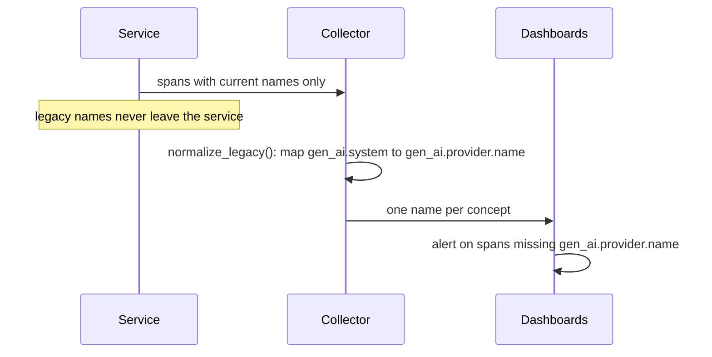

This article targets **opentelemetry-sdk 1.45.1** (the latest release on PyPI as of 2026-10-20), **Python 3.12**, and the OpenTelemetry GenAI semantic conventions as pinned at dedicated-repo commit `547934af` (2026-10-20). The provider in the code is a deterministic stub, so every measurement below is reproducible with no model access.

In June 2026, the OpenTelemetry project did something unusual with a telemetry contract that thousands of teams had already built on. It did not stabilize it. It moved it. Release v1.42.0 of the semantic conventions deprecated every `gen_ai.*` attribute, metric, event, and span, and pointed at a brand-new repository, `open-telemetry/semantic-conventions-genai`, created 2026-05-05. As of this writing that repository has **zero tagged releases**, and every GenAI signal in it is still marked Development. The names moved too: the attribute your dashboards filter on, `gen_ai.system`, is gone from the new repo; its replacement is `gen_ai.provider.name`.

This guide shows how to instrument LLM calls against that moving contract without getting burned: pin the convention snapshot, emit exactly the current names, dual-read during the migration, keep prompts opt-in, and derive cost downstream from tokens. The complete module is [genai_observe.py](genai_observe.py), the pinned snapshot is [convention.py](convention.py), and the proofs are [test_conformance.py](test_conformance.py), sixteen tests, all passing.

> [!NOTE]
> **In short**
> - Pin the convention snapshot (repo + commit + date), not "the OTel docs". The names have moved before and the repo has no releases to pin instead.
> - Emit current names only: span `gen_ai.client.inference` named `{operation} {model}`, with Required `gen_ai.operation.name` and `gen_ai.provider.name`. Never emit `gen_ai.system`; it is the old name.
> - Keep prompt and completion content off spans by default. `gen_ai.input.messages` and `gen_ai.output.messages` are Opt-In in the spec for a reason.
> - Record tokens, not dollars. Cost is token counts times a dated price table, computed downstream; a span that tries to carry cost goes stale the next pricing change.
> - During migration, map legacy names to current names once, at the collector, and alert on any span that still carries a legacy name.

## The contract that moved

The OpenTelemetry GenAI conventions standardize the telemetry every LLM platform emits: one span per model call, with the operation, provider, model, token counts, and timing; metrics for durations and token usage; events for inputs and outputs. The v1.42.0 release notes say it plainly: "All `gen_ai.*` attributes, metrics, events, and spans have been deprecated and moved to the dedicated OpenTelemetry GenAI Semantic Conventions Repository."

The dedicated repo extends the main conventions with GenAI-specific ones using Weaver, and it covers GenAI clients, MCP, and provider-specific conventions. What it does not have, yet, is a release. Zero tags, zero published releases, 668 commits on main. The old location now reads "This page has moved and is no longer maintained in this repository." So there is no version number to pin. The honest pin is a commit: `547934af`, read on 2026-10-20. That is what `convention.py` records, along with the exact attribute and metric names the code is allowed to emit.

{: .figure}

The renames are the part that bites. Verified by diffing the main repo's GenAI docs at tag v1.36.0 against the dedicated repo's current docs:

- `gen_ai.system` (Required in v1.36.0) is now `gen_ai.provider.name` (Required).
- The metric prefix `gen_ai.client.operation.*` became `gen_ai.client.inference.*` (for example `time_to_first_chunk`).
- `gen_ai.usage.cache_creation.input_tokens` became `gen_ai.usage.cache_write.input_tokens`.
- `gen_ai.request.top_k` changed type from double to int and was scoped to decoding; retrieval got its own `gen_ai.retrieval.top_k`.

An instrumentation built on the old names keeps emitting the old names. A dashboard built on the new names goes empty. Nothing errors anywhere. That silent uncorrelated failure is the core failure mode of this whole topic, and everything below is built to make it loud instead.

## The three signals of one chat call

Per `client-inference.md`, one chat call produces a client span of type `gen_ai.client.inference`. The span name SHOULD be `{gen_ai.operation.name} {gen_ai.request.model}`, so `chat stub-model-1`. Two attributes are Required on every such span: `gen_ai.operation.name` (`chat`, `generate_content`, `embeddings`, `execute_tool`, `invoke_agent`, and others) and `gen_ai.provider.name`. The request model is conditionally required when available, and the token counts (`gen_ai.usage.input_tokens`, `gen_ai.usage.output_tokens`, plus `cache_read`/`cache_write` input tokens and `reasoning` output tokens when non-zero) are Recommended. Response identity rides along as Recommended: `gen_ai.response.model`, `gen_ai.response.id`, `gen_ai.response.finish_reasons`.

The metrics mirror the span: `gen_ai.client.inference.duration`, `gen_ai.client.inference.time_to_first_chunk`, `gen_ai.client.inference.time_per_output_chunk`, and per-direction token usage histograms. Note what is absent: there is no cost metric and no quality metric. The conventions record tokens, not currency, because prices change and vary by contract; scores and prompt versions live outside OpenTelemetry entirely.

And the content attributes, `gen_ai.input.messages`, `gen_ai.output.messages`, `gen_ai.system_instructions`, `gen_ai.tool.definitions`, are all **Opt-In**. That is the spec telling you that recording prompts is a privacy decision, not a default.

{: .figure}

## Implementation: emit only current names

`convention.py` holds the pinned snapshot: the commit, the current attribute and metric names, the legacy rename map, and three predicates (`find_legacy`, `missing_required`, `unknown`). The observer in `genai_observe.py` builds on it:

```python
class GenAIObserver:
    """Emit GenAI-convention spans and metrics around a provider call.

    Prompts and completions are Opt-In attributes in the conventions, so
    ``capture_content`` defaults to False: with it off, no message content
    ever lands on a span, and a collector never has to redact what was never
    recorded.
    """

    def __init__(self, tracer=None, meter=None, capture_content: bool = False):
        self._tracer = tracer or trace.get_tracer("genai_observe")
        self._meter = meter or get_meter("genai_observe")
        self._capture_content = capture_content
        self._duration = self._meter.create_histogram(
            name=METRIC_DURATION,
            unit="s",
            description="Duration of a GenAI inference call",
        )
```

The `chat` method opens the span with the spec-mandated name, sets the Required attributes first, then the Recommended ones only when the data exists, and records the duration histogram with the same attributes so metrics and traces join:

```python
    def chat(self, provider: StubProvider, operation: str, messages: list[dict],
             **request_options) -> ChatResult:
        request_model = provider.model
        span_name = f"{operation} {request_model}"  # SHOULD per client-inference.md
        attrs = {
            "gen_ai.operation.name": operation,
            "gen_ai.provider.name": request_options.pop("provider_name", "stub"),
            "gen_ai.request.model": request_model,
        }
```

A failed provider call is recorded as an exception on the span and the span status is set to ERROR before the exception propagates: a retried call that never appears in traces is how you lose the one signal that explains a latency spike. Speaking of retries, the backoff policy itself deserves the same rigor as the telemetry; see [Retries with Exponential Backoff and Jitter](/posts/retries-with-exponential-backoff-and-jitter/).

Two deliberate choices are worth calling out. First, the emit side knows only current names; legacy names never leave the service. The `normalize_legacy` mapping runs at the collector, once, so old instrumentations can be retired on their own schedule while dashboards query one name. Second, the provider here is a stub returning deterministic token counts. That is not a shortcut: it is what makes the sixteen tests below measurements rather than anecdotes. Nothing in this article depends on a real model, and no model behavior is claimed.

## Failure modes: the three production mistakes

**1. Emitting legacy names against new-name dashboards.** The team upgrades its dashboards to `gen_ai.provider.name` after reading the new docs, but the instrumentation library still emits `gen_ai.system`. Every panel that filters on the provider goes empty; the old panels keep working, so nobody notices the new ones are blind until an incident needs them. The fix is structural: the emit side carries the pinned snapshot and `check_conformance` fails the build on any legacy or unknown attribute, while the collector maps legacy to current for the dashboards during the transition. The test `test_legacy_fixture_is_caught` proves a span carrying `gen_ai.system` is flagged with its replacement.

**2. Recording prompts and completions by default.** The spec marks content attributes Opt-In because prompts carry PII, secrets pasted by users, and retrieved documents that may be confidential. An instrumentation that records `gen_ai.input.messages` unconditionally ships all of that into the trace backend, where retention and access controls were designed for timings, not content. Treat prompts and tool outputs as untrusted input here too: the defense is to not record them unless explicitly enabled, and to redact at the collector when they are. The OAuth discovery article on this blog makes the same point from the other direction: [Validate the Issuer](/posts/oauth-discovery-issuer-validation/) shows what happens when untrusted protocol content is treated as safe. In this module `capture_content` defaults to False, and `test_prompts_off_by_default` asserts no content attribute appears on the span.

**3. Treating spans as a cost ledger.** The conventions record tokens; cost is tokens times price, and the price is not in the span. Two traps follow. First, cache and reasoning tokens are only Recommended "when available and non-zero", so a naive `input_tokens + output_tokens` sum silently drops the tokens that change the bill: 400 cached input tokens at a tenth of the price, 60 reasoning tokens at full output price. Second, prices move and differ by contract, so a dollar figure baked into a span goes stale on the next pricing change. The `CostLedger` takes token counts from spans and multiplies by a price table keyed on `(provider, model)` with the date the prices were read, pricing each token class at its own rate. An unknown pair raises `KeyError` instead of pricing at zero: a silent $0 is how a budget alert goes blind. `test_cost_includes_cache_and_reasoning_tokens` checks the arithmetic to the decimal.

## Proving it works

The suite runs against the stub provider on opentelemetry-sdk 1.45.1, Python 3.12, with deprecation warnings as errors. Sixteen tests, all passing:

```console
$ python -m pytest test_conformance.py -q
................                                                          [100%]
16 passed in 1.89s
```

The tests cover four groups. The contract: the snapshot is pinned to one commit, the span name follows the spec rule, Required attributes are present, every emitted attribute is in the pinned set, and the duration metric is recorded. The migration: a legacy-attribute fixture is caught with its replacement named, a missing required attribute is reported, and the collector-side `normalize_legacy` maps all three cited renames. The three mistakes: prompts are absent by default and present when opted in, the cost math includes cache and reasoning tokens at their own rates, and an unknown model raises instead of pricing at zero. Error handling: a failing provider call leaves an ERROR span.

The migration itself is a sequence worth drawing, because the ordering is the whole trick: new names at the edge, mapping in the middle, one name in the dashboards.



`DualReadDashboard.read` implements the merge for tests: legacy readings are normalized, current readings win on conflict, and no legacy name survives. When the last old instrumentation is retired, delete the mapping. Dual emission is a migration state, not an architecture.

## Operating it

Once the spans flow, four things deserve alerts, with the exact names from the pinned snapshot:

- **Latency:** `gen_ai.client.inference.duration`, p50/p99 by `gen_ai.provider.name` and `gen_ai.request.model`. A p99 jump on one model while others are flat is a provider problem, not yours.
- **Token burn:** the `gen_ai.client.inference.usage.*` histograms, split by `cache_read` and `reasoning`. A rising `reasoning.output_tokens` share means your prompts are buying more thinking than they used to.
- **Errors and retries:** ERROR spans on `gen_ai.client.inference`, grouped by `gen_ai.response.finish_reasons`. A climb in `length` finish reasons is a `max_tokens` misconfiguration, not a model failure.
- **Convention drift:** a collector-side check that every `gen_ai.client.inference` span carries `gen_ai.provider.name`. Missing provider names mean an instrumentation regressed to old names or a new service shipped without the observer. This is the alert that would have caught mistake 1 before the dashboards went blind.

Cost alerting sits one layer downstream: the ledger consumes token histograms and the dated price table, and alerts on projected spend per provider, model, and team. Keep the price table in version control with the date it was read; when the provider reprices, the diff is the audit trail.

For MCP servers specifically, the dedicated repo also ships [MCP semantic conventions](https://github.com/open-telemetry/semantic-conventions-genai/blob/main/docs/gen-ai/mcp.md) (Development), which recommend the MCP spans over generic RPC conventions for tool calls. If you run MCP servers, the same pin-and-conform discipline applies to `tools/call` spans. The protocol side of that story, writing the servers themselves for the stateless 2026-07-28 spec, is [MCP 2026-07-28: Writing Servers for the Stateless Protocol](/posts/mcp-stateless-servers/).

## Trade-offs and alternatives

This level of instrumentation is not always worth it. If your system is a single stateless endpoint whose only failure mode is "the call failed", structured logs with the model name and token counts give you the same answers for less machinery. Traces pay off when a request fans out: an agent run with retrieval, several model calls, and tool invocations, where the question is which step burned the tokens and the seconds.

The alternatives each pick a different contract. Vendor SDKs (Langfuse, LangSmith, Braintrust) give you richer product surfaces, prompt versioning, and evaluation datasets, but their trace schema is theirs; you are renting the contract. OpenLLMetry and OpenLIT emit OpenTelemetry with their own attribute choices, which today disagree with each other on exactly the names this article pins. Manual spans with your own attribute names are the cheapest start and the most expensive migration later: you will rename everything the week the team standardizes.

My recommendation: emit the current OTel GenAI names from your own thin wrapper, pin the snapshot, and keep vendor SDKs for the product features (datasets, evals) rather than the telemetry contract. The wrapper is a hundred lines; the migration it saves you from is a quarter.

## Checklist

- [ ] The convention snapshot is pinned: repo, commit, and the date you read it, in the codebase.
- [ ] Every `gen_ai.client.inference` span carries `gen_ai.operation.name` and `gen_ai.provider.name`; the span name is `{operation} {model}`.
- [ ] No legacy attribute (`gen_ai.system`, `gen_ai.client.operation.*`, `gen_ai.usage.cache_creation.*`) is emitted; CI fails on them.
- [ ] Prompt and completion content is off by default; enabling it is a reviewed decision with a retention policy.
- [ ] Token counts include cache and reasoning breakdowns wherever the provider reports them.
- [ ] Cost is computed downstream from tokens and a dated price table; unknown models raise, never price at zero.
- [ ] The collector maps legacy to current names, dashboards query one name, and an alert fires on spans missing `gen_ai.provider.name`.
- [ ] When the conventions change, update the pinned snapshot and re-run the conformance suite before any dashboard change.

## References

- [Semantic conventions v1.42.0 release notes](https://github.com/open-telemetry/semantic-conventions/releases/tag/v1.42.0), *open-telemetry/semantic-conventions* (2026-06-12): all `gen_ai.*` attributes, metrics, events, and spans deprecated and moved to the dedicated repository.
- [Semantic conventions for generative AI systems](https://github.com/open-telemetry/semantic-conventions-genai/blob/main/docs/gen-ai/README.md), *open-telemetry/semantic-conventions-genai*: the dedicated repo; all signals Development, zero tagged releases.
- [Semantic Conventions for Generative AI inference operations](https://github.com/open-telemetry/semantic-conventions-genai/blob/main/docs/gen-ai/client-inference.md), *open-telemetry/semantic-conventions-genai*: the `gen_ai.client.inference` span, its Required attributes, the span-name rule, Opt-In content attributes, and the inference metrics.
- [Semantic Conventions for GenAI agent operations](https://github.com/open-telemetry/semantic-conventions-genai/blob/main/docs/gen-ai/gen-ai-agent-spans.md), *open-telemetry/semantic-conventions-genai*: `create_agent` and `invoke_agent` spans; `gen_ai.provider.name` as the discriminator.
- [Semantic conventions for Model Context Protocol (MCP)](https://github.com/open-telemetry/semantic-conventions-genai/blob/main/docs/gen-ai/mcp.md), *open-telemetry/semantic-conventions-genai*: MCP spans preferred over generic RPC conventions for tool calls.
- [Python](https://opentelemetry.io/docs/languages/python/), *OpenTelemetry docs*: traces and metrics Stable, logs Development; OpenTelemetry-Python supports Python 3.10+.
