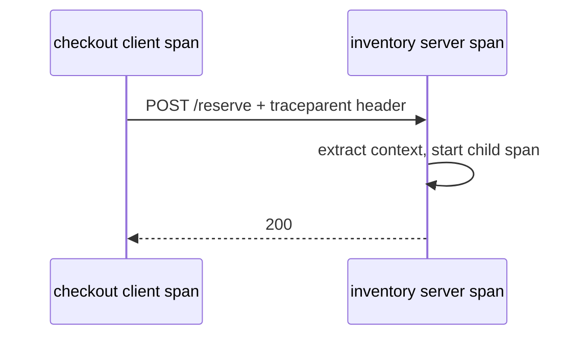

Versions this article targets: Python 3.12, opentelemetry-api and
opentelemetry-sdk 1.45.1, opentelemetry-instrumentation-requests 0.66b1.
Traces and metrics are stable in this release; logs are still in
development. If you run an older release, the semconv section below is
where your setup differs.

A checkout service gets its first traces the easy way: install the
distro, run the app under `opentelemetry-instrument`, and watch spans
appear for every HTTP call and database query. The traces look complete.
Then an incident arrives, and the engineer on call searches for the
checkout operation and finds nothing by that name. The trace is a pile
of library calls: `GET`, `SELECT`, `GET`. The latency is visible; the
operation that owns it is not.

A second incident arrives a month later. Someone opted the fleet into
the stable semantic conventions, and every dashboard built on
`http.status_code` goes dark, because the spans now carry
`http.response.status_code` instead. Nothing broke in the service. The
telemetry changed names underneath the queries.

A third problem is quieter and worse: the trace backend holds full URLs
with query strings, user ids in paths, and one time series per order
id. That is a cardinality bill and a data leak, discovered at renewal
time.

This guide fixes all three before they happen. One idea: a trace is
only useful if it names the business operation, uses attribute names
you chose deliberately, and carries values you would show a stranger.

> [!NOTE]
> In short:
>
> - Start with zero-code instrumentation for library spans, then add one
>   manual span per business operation. The manual span is the span
>   on-call searches for.
> - Decide the semantic convention set before building dashboards:
>   default (old names), `http/dup` (both, during migration), or `http`
>   (stable names only). Never let it flip by accident.
> - Propagate context across every service boundary with the W3C
>   traceparent header, and verify the child span shares the trace id.
> - Record route templates, not raw paths; strip query strings before
>   they become attributes.
> - Set the sampler explicitly. The SDK default samples every root
>   trace, which is a cost decision made by omission.

## Zero-code first, then one manual span

Zero-code instrumentation is the right starting point. It monkey-patches
supported libraries at runtime, so a Flask, Django, or requests-based
service emits spans without code changes:

```bash
pip install opentelemetry-distro opentelemetry-exporter-otlp
opentelemetry-bootstrap -a install
OTEL_SERVICE_NAME=checkout-service \
OTEL_TRACES_EXPORTER=console,otlp \
OTEL_EXPORTER_OTLP_TRACES_ENDPOINT=0.0.0.0:4317 \
opentelemetry-instrument python myapp.py
```

I ran this against a small requests-based script on 2026-10-29 with
SDK 1.45.1. It produced a `GET` client span with no application code
for tracing at all. That is the value and the limit of zero-code: it
records what libraries did, not what the business did.

The manual span closes that gap. A tracer provider with an explicit
sampler, a business span that owns the operation, and a child span for
the outbound call:

```python
from opentelemetry import trace
from opentelemetry.sdk.trace import TracerProvider
from opentelemetry.sdk.trace.export import SimpleSpanProcessor
from opentelemetry.sdk.trace.export.in_memory_span_exporter import (
    InMemorySpanExporter,
)
from opentelemetry.sdk.trace.sampling import (
    ParentBased,
    TraceIdRatioBased,
)
from opentelemetry.trace import SpanKind, Status, StatusCode

SERVICE_NAME = "checkout-service"


def build_provider(sampler=None):
    """Build a TracerProvider wired to an in-memory exporter.

    Production code uses BatchSpanProcessor and an OTLP exporter; the
    in-memory exporter exists so tests can read the finished spans.
    The sampler defaults to the SDK default (ParentBased AlwaysOn);
    pass an explicit sampler in production instead of relying on it.
    """
    exporter = InMemorySpanExporter()
    provider = TracerProvider(sampler=sampler)
    provider.add_span_processor(SimpleSpanProcessor(exporter))
    return provider, exporter


def production_sampler():
    """Sample 10 percent of root traces, honour a sampled parent.

    ParentBased means: if an upstream service already sampled this
    trace, keep sampling it end to end; otherwise apply the ratio.
    A ratio of 1.0 (the SDK default via parentbased_always_on) on a
    busy service exports every trace and pays for it in the backend.
    """
    return ParentBased(root=TraceIdRatioBased(0.1))


def checkout(tracer, item_count, inventory_ok=True):
    """One business operation, traced as one named span.

    The ``checkout`` span is the span an on-call engineer searches
    for. Library spans underneath it explain the latency; without
    this span the trace is a pile of HTTP calls with no owner.
    """
    with tracer.start_as_current_span("checkout", kind=SpanKind.SERVER) as span:
        span.set_attribute("order.item_count", item_count)
        span.set_attribute("order.currency", "USD")
        try:
            with tracer.start_as_current_span(
                "reserve_inventory", kind=SpanKind.CLIENT
            ) as child:
                child.set_attribute("server.address", "inventory.internal")
                if not inventory_ok:
                    raise RuntimeError("inventory service refused")
                child.add_event("inventory reserved")
        except RuntimeError as exc:
            # Status UNSET means "finished without error" to a backend.
            # A span that owns a failure must say so, and the exception
            # event carries the type and message for the alert query.
            span.set_status(Status(StatusCode.ERROR, str(exc)))
            span.record_exception(exc)
            raise
        return {"reserved": item_count}
```

The full file, including the URL helpers used later, ships next to this
article as [tracing.py](tracing.py). The span tree it produces is the
article's mental model:

{: .figure}

Two details in this code deserve emphasis. First, the span kind is set
explicitly: `SERVER` for the operation that handles a request, `CLIENT`
for the outbound call. Kind is how backends draw the service graph; a
span with the default `INTERNAL` kind looks like a local function call
and never connects two services in the graph. Second, the error path
sets status `ERROR` and records the exception before re-raising. A span
left at the default `UNSET` status reads as success in every backend
query, including the one that pages on-call.

## Context propagation is the trace

A trace is not a collection of spans from one process. It is a trace id
carried across process boundaries, and the carrier is the W3C
`traceparent` header. The client injects it; the server extracts it and
starts its span as a child of the extracted context. The demo shipped
with this article ([demo.py](demo.py)) does exactly that with the
standard library: a client span injects headers into a `urllib`
request, and the server extracts them before starting `POST /reserve`:



Running `python3 demo.py` on 2026-10-29 printed matching trace ids and
confirmed the server span's parent is the client span (the hex ids vary
per run; the relationships do not):

```console
client trace id: 3c2b2c6be93c6125076611e4a157be9e
server trace id: 3c2b2c6be93c6125076611e4a157be9e
server parent:   41b43f0a288557a7
client span id:  41b43f0a288557a7
same trace: True
server is child of client: True
```

If the server span starts fresh instead of from the extracted context,
the trace splits in two at every hop, and the backend shows two
unrelated traces for one checkout. When a trace looks truncated at a
service boundary, the first thing to check is whether that service
extracts before it starts its span. The default propagators are W3C
Trace Context and W3C Baggage; if a caller uses B3 or Jaeger headers,
set `OTEL_PROPAGATORS` to match, or the extraction silently yields
nothing and the trace splits anyway.

## The convention decision: old names, both, or stable

This is the decision most teams make by accident. The HTTP semantic
conventions went stable in version 1.23.1, renaming the attributes
every dashboard queries: `http.method` became
`http.request.method`, `http.status_code` became
`http.response.status_code`, `http.url` became `url.full`, and
`net.peer.name` became `server.address`. The database conventions are
stable too, with the same migration shape: `database` and
`database/dup` values for `OTEL_SEMCONV_STABILITY_OPT_IN`.

The migration rule, from the specification, is explicit: with no
opt-in value, instrumentation keeps emitting the old names. With
`http`, it emits only the stable names. With `http/dup`, it emits
both, so dashboards can move one query at a time. The same rule
applies per category, so a service can run `http,database/dup` while
its database dashboards catch up.

{: .figure}

I measured this on 2026-10-29 with the requests instrumentation
0.66b1 rather than trusting the docs. The probe ([probe_semconv.py](probe_semconv.py))
makes one request to a local server and prints the span attributes:

- Default: `http.method`, `http.status_code`, `http.url`,
  `user_agent.original`.
- `OTEL_SEMCONV_STABILITY_OPT_IN=http`: `http.request.method`,
  `http.response.status_code`, `url.full`, `server.address`,
  `network.peer.address`, `network.peer.port`,
  `network.protocol.version`, `user_agent.original`.
- `OTEL_SEMCONV_STABILITY_OPT_IN=http/dup`: both sets at once.

The practical sequence is: ship with the default, build nothing
permanent on it, run `http/dup` while dashboards and alerts move to
stable names, verify the stable queries return data, then switch to
`http`. The failure mode is doing this in the other order: opting into
stable names first and discovering that the alert that pages on
`http.status_code` has been querying a series that no longer exists.

One more version note for teams upgrading to 1.45.1: it is a patch
release on 1.45.0. The fixes are a tracestate header quadratic-time
parsing bug (headers longer than 8192 characters are now discarded),
a thread leak in resource detector initialization for long-running
processes, and restoring `requests` as the default OTLP HTTP transport
so proxy environment variables such as `HTTPS_PROXY` are honored
again. If your exporter runs behind a proxy, 1.45.1 is the version to
run, not 1.45.0.

## Cardinality and sensitive values: what not to record

The same probe exposed the third problem. The default `http.url`
attribute carried the full URL, query string included:

```console
http.url: http://127.0.0.1:43177/orders/42?token=secret
```

That token is now in the trace backend, retained on the backend's
schedule, visible to everyone with trace read access. Two helpers fix
the class of problem, and both ship in [tracing.py](tracing.py):

```python
import re
from urllib.parse import urlparse

_ID_SEGMENT = re.compile(r"\A([0-9]+|[0-9a-f]{8}-[0-9a-f]{4}-[0-9a-f]{4}-[0-9a-f]{4}-[0-9a-f]{12})\Z")


def sanitize_url(url):
    """Return the URL without query string or fragment.

    Instrumentations record the full URL by default, so a URL like
    ``https://shop.example/orders?token=secret`` lands in the trace
    backend verbatim. Strip it before the value ever becomes an
    attribute; the route template, not the query, is the grouping key.
    """
    parsed = urlparse(url)
    return f"{parsed.scheme}://{parsed.netloc}{parsed.path}"


def normalize_path(path):
    """Replace id-like path segments with ``{id}``.

    ``/orders/12345/items`` and ``/orders/98765/items`` are the same
    operation. Recording the raw path creates one time series per
    order id; the route template keeps cardinality bounded.
    """
    parts = []
    for segment in path.split("/"):
        if _ID_SEGMENT.match(segment):
            parts.append("{id}")
        else:
            parts.append(segment)
    return "/".join(parts)
```

The rule behind both: an attribute value is a grouping key in the
backend. Every distinct value is a series. User ids, order ids, and
query strings are unbounded sets, so they produce unbounded series and
unbounded storage. Route templates (`GET /orders/{id}`), methods,
server addresses, and currency codes are bounded sets, so they group.
The same rule applies to database spans: the query summary groups,
the raw query text with literals does not, and parameter values are
opt-in for exactly this reason.

{: .figure}

## Failure modes: the three production mistakes

**1. Dashboards built on default attribute names.** A team enables
zero-code instrumentation, builds latency dashboards on `http.method`
and error alerts on `http.status_code`, and months later upgrades the
instrumentation or sets the opt-in. The stable names arrive, the old
series stops, and the alerts go quiet without anyone touching them.
The fix is ordering: choose the convention set first, run `http/dup`
while queries move, and treat an attribute rename as a migration with
a checklist, not a flag flip. The same applies to the database
conventions and their `database/dup` value.

**2. Auto-instrumentation with no business span and no error status.**
The trace shows library calls but no operation, so on-call cannot
search for the thing that failed. And when the operation does fail,
the span that owns it sits at status `UNSET`, which backends read as
success. The fix is the pattern in `checkout` above: one manual span
per business operation, kind set, status `ERROR` plus a recorded
exception on the failure path, and the exception re-raised so the
caller still sees it. A span that swallows the exception to look clean
is worse than no span.

**3. High-cardinality and sensitive attributes, plus unbounded
sampling.** Full URLs with query strings, user ids in paths, and raw
query text with literals all reach the backend by default, and the
default sampler (`parentbased_always_on`) exports every root trace.
The fix has two parts: sanitize before recording, as in the helpers
above, and set the sampler explicitly, for example
`ParentBased(root=TraceIdRatioBased(0.1))`, which keeps a sampled
parent's decision end to end while cutting root volume to 10 percent.
Note the trade: a 10 percent sampler drops 90 percent of traces, so
error paths need their own signal. An error counter or a metric on
the failure, not the trace, is what pages on-call when the trace for
a specific failed request was never sampled.

## Proving it works

The test suite ([test_tracing.py](test_tracing.py)) runs 10 tests
against SDK 1.45.1, all passing on 2026-10-29 with deprecation
warnings treated as errors:

- Sanitizing strips query strings and fragments; path normalization
  generalizes numeric and UUID segments but leaves route words alone.
- The `checkout` span tree has the right parentage, kinds, and
  attributes, and its status is `UNSET` on success.
- A failed checkout marks the business span `ERROR` and records an
  `exception` event, then re-raises.
- A ratio sampler of 0.0 exports nothing and 1.0 exports the span;
  a `ParentBased` sampler with an unsampled root still keeps a
  sampled parent's trace.
- The propagation demo round trip: server span shares the client
  span's trace id and names it as parent.
- The semconv probe in a subprocess: default emits old names and
  carries `token=secret` in `http.url`; the `http` opt-in emits
  stable names and no old ones.

Tests that need the requests instrumentation skip when it is not
installed, following the pattern of the blog's earlier cache article.
Ran 10 tests, 10 passing.

## Operating it

Once the service ships traces, these are the checks that keep them
useful:

- **Convention drift check.** Query the backend for spans carrying
  `http.method` in the last day. Any result after the migration means
  a service still runs old conventions; find it by `service.name`
  and move it to `http/dup`, then `http`.
- **Cardinality check.** List the top attribute values by series
  count for `url.path` and `http.route`. A value that looks like an
  id, a token, or a timestamp is a sanitizer gap; fix it at the
  source, not with a backend drop rule.
- **Sampling check.** Compare the trace count against the request
  count for one service. If traces equal requests, the sampler is
  still the default; if traces are far below the configured ratio,
  a parent upstream is forcing unsampled decisions.
- **Error status check.** Alert on spans with status `ERROR` grouped
  by the business span name, not by the library span name. The
  business span is the unit the team owns.
- **Export health.** A `BatchSpanProcessor` drops spans when its
  queue fills (default queue 2048, batch 512, schedule delay 5000
  ms). Export failures surface in SDK logs, not in the service's
  error rate, so watch the exporter, or a silent backend outage
  looks like a healthy service with no traces.

## Trade-offs and alternatives

Manual spans cost maintenance: every business operation needs one,
and a renamed operation orphans old dashboards just like a renamed
attribute. The alternative, pure zero-code tracing, costs nothing to
maintain but answers only library-level questions. For a service with
three operations, manual spans win easily. For a service with three
hundred, zero-code plus a small number of manual spans on the
operations that page is the honest middle.

Sampling trades completeness for cost. Always-on sampling is correct
for low-traffic services and for debugging sessions, and it is the
wrong default for a service doing thousands of requests per second.
Tail sampling (deciding after the trace completes, keeping errors and
slow traces) is the better end state, but it needs a collector with
that policy; the SDK's head sampler cannot see the outcome. Until
then, a head ratio plus error metrics is the workable version.

Structured logs are the alternative readers reach for first, and they
remain better for single-process debugging. What logs cannot do is
follow one request across services with one id. If the system is one
process, logs plus metrics may be enough. The moment a request
crosses a boundary, the trace id is the only cheap join key.

The recommendation: zero-code instrumentation on day one, manual
business spans on the operations that page, stable conventions chosen
before dashboards exist, sanitized attributes from the start, and an
explicit sampler. That is the whole setup, and it survives the three
mistakes above.

## Checklist

- [ ] Zero-code instrumentation running, with `service.name` set.
- [ ] One manual span per business operation that pages, kind set.
- [ ] Convention set chosen (`http` or `http/dup` during migration);
  no dashboard queries old names after the switch.
- [ ] Query strings stripped and id segments generalized before any
  value becomes an attribute.
- [ ] Error paths set status `ERROR`, record the exception, and
  re-raise.
- [ ] Sampler set explicitly, not left at the always-on default.
- [ ] Propagation verified end to end: one trace id across a real
  service boundary, in a test.
- [ ] Export health monitored: queue, batch, and exporter errors.

## References

- [OpenTelemetry Python documentation](https://opentelemetry.io/docs/languages/python/)
- [Python zero-code instrumentation](https://opentelemetry.io/docs/zero-code/python/)
- [Manual instrumentation for OpenTelemetry Python](https://opentelemetry.io/docs/languages/python/instrumentation/)
- [HTTP semantic convention stability migration](https://opentelemetry.io/docs/specs/semconv/non-normative/http-migration/)
- [Semantic conventions for database client spans](https://opentelemetry.io/docs/specs/semconv/database/database-spans/)
- [Release Version 1.45.1/0.66b1](https://github.com/open-telemetry/opentelemetry-python/releases/tag/v1.45.1)
- [Environment Variable Specification](https://opentelemetry.io/docs/specs/otel/configuration/sdk-environment-variables/)

The blog's earlier article on [Tracing LLM Calls with the OpenTelemetry GenAI Conventions](/posts/tracing-llm-calls-otel-genai/) covers the
GenAI convention set that moved to its own repository; the conventions
here are the stable HTTP and database sets. For the failure mode where
a fix is retried without a bound, see [Retries with Exponential Backoff and Jitter](/posts/retries-with-exponential-backoff-and-jitter/).
And for the pattern of recording an event durably instead of hoping a
downstream call succeeds, see [Transactional Outbox: Reliable Events Without Dual Writes](/posts/transactional-outbox-reliable-events-without-dual-writes/).
